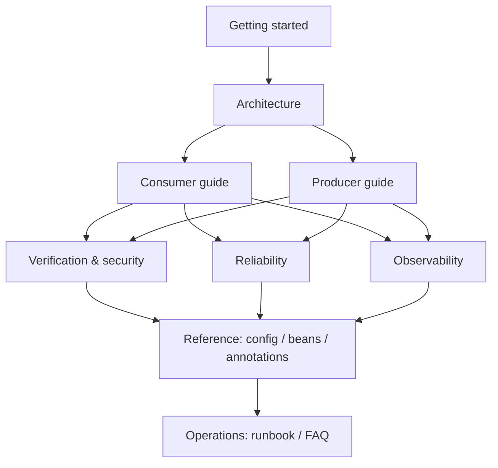

# Webhooks Toolkit — Documentation

A [Standard Webhooks](https://www.standardwebhooks.com/)-compliant toolkit for **sending** and
**receiving** webhooks in Spring Boot, delivered as two drop-in auto-configuration libraries with a
deliberate **no-storage** design.

This is the full documentation set. New here? Start with **[Getting started](./getting-started.md)** — a
signed webhook end-to-end in a few minutes — then read the guide for the side you care about.

---

## Documentation map

**Text summary.** Getting started → Architecture gives the mental model. From there, the Consumer and
Producer guides cover each side; Verification & security, Reliability, and Observability are cross-cutting
concerns both sides share; the Reference section is the lookup material (every config key, every
replaceable bean, every annotation); Operations covers running it in production.

---

## Contents

### Start here
- **[Getting started](./getting-started.md)** — receive and send your first signed webhook.
- **[Architecture](./architecture.md)** — the two libraries, the wire format, and the no-storage design, with diagrams.

### Guides (by topic)
- **[Consumer guide](./guides/consumer.md)** — the receive pipeline: endpoints, `@WebhookType` events, `@WebhookHandler`, schema validation, unknown-type policy.
- **[Producer guide](./guides/producer.md)** — the send pipeline: `@WebhookClient`, named destinations, envelope building and signing.
- **[Verification & security](./guides/verification-and-security.md)** — HMAC verification, the replay window, secret rotation, SSRF guard, redaction-safe logging.
- **[Transport authentication](./guides/transport-authentication.md)** — adding an OAuth2 `Authorization: Bearer` token on both sides, alongside the HMAC signature.
- **[Reliability](./guides/reliability.md)** — in-process retry & backoff, honoring `Retry-After`, sync vs async handling, dead-letter failure hooks.
- **[Observability](./guides/observability.md)** — structured logging, `webhook-id` correlation, delivery/event lag, opt-in metrics, tracing.

### Reference (lookup)
- **[Configuration reference](./reference/configuration.md)** — every `webhooks.*` property, with type and default.
- **[Beans & extension points](./reference/beans-and-spis.md)** — the supported replaceable beans / SPIs.
- **[Annotations](./reference/annotations.md)** — `@WebhookType`, `@Redact`, `@WebhookHandler`, `@WebhookClient`, `@EnableWebhookClients`.
- **[HTTP status codes](./reference/http-status-codes.md)** — what the consumer returns and why.

### Operations
- **[Runbook](./operations/runbook.md)** — deployment topology, scaling, failure modes, what to alert on.
- **[FAQ](./operations/faq.md)** — common questions and gotchas.

### Deep references
- **[`SPEC.md`](./reference/SPEC.md)** — the full internal design specification.
- **[`STANDARD_WEBHOOKS.md`](./reference/STANDARD_WEBHOOKS.md)** — the protocol reference (headers, signature, payloads).

---

## At a glance

| | Consumer | Producer |
| --- | --- | --- |
| **You write** | a `@WebhookType` event class + a `@WebhookHandler` method | a `@WebhookClient` interface |
| **Library does** | verify → deserialize → (schema) → dispatch | build envelope → sign → deliver (retry) |
| **Config root** | `webhooks.consumer.*` | `webhooks.producer.*` |
| **Stores** | nothing | nothing |

## Requirements

| Requirement | Version |
| --- | --- |
| Java | 21 |
| Spring Boot | 3.5.x |
| Maven | 3.9+ |
