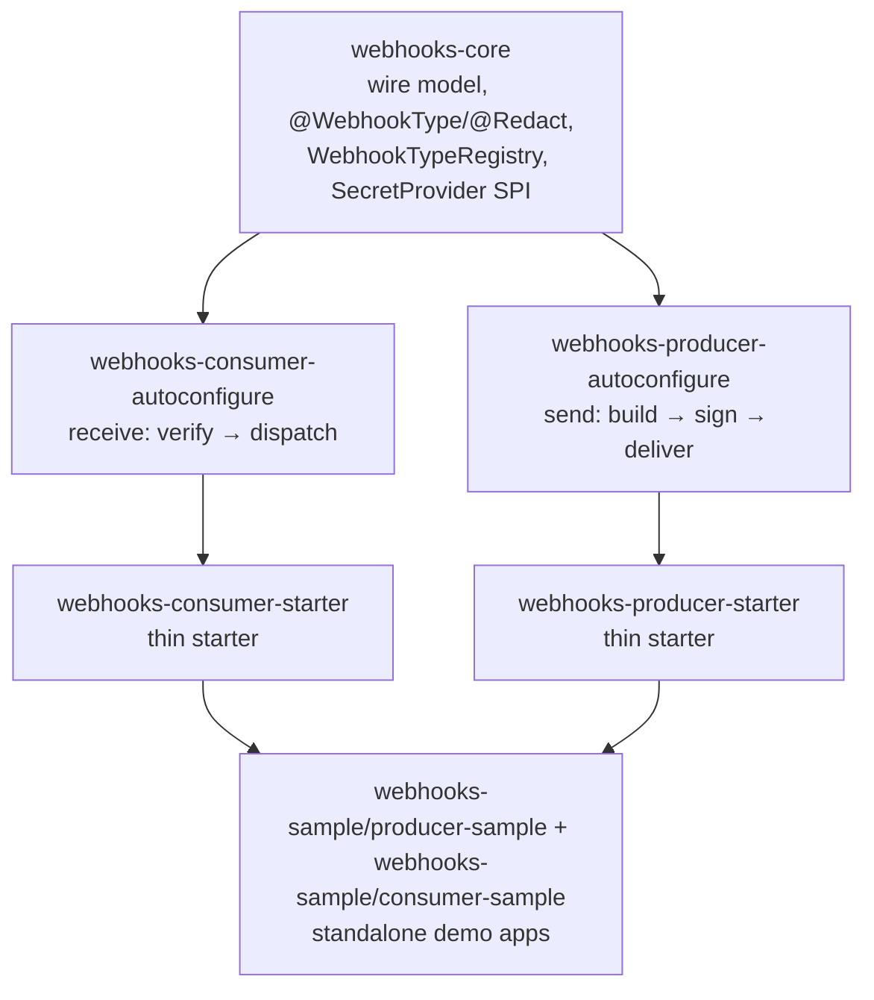
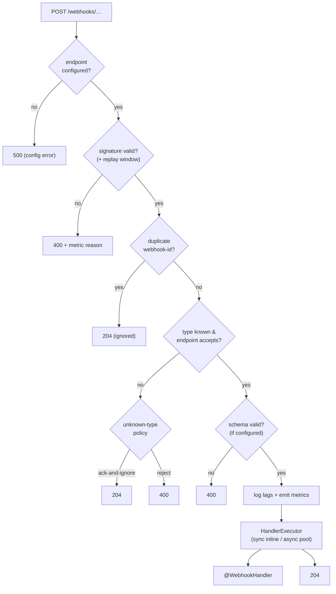
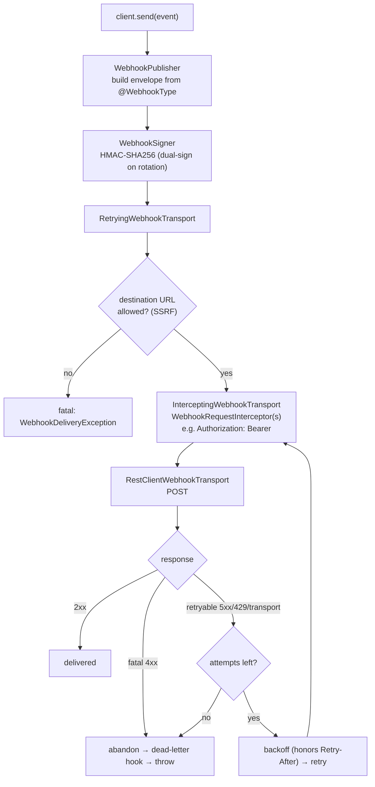
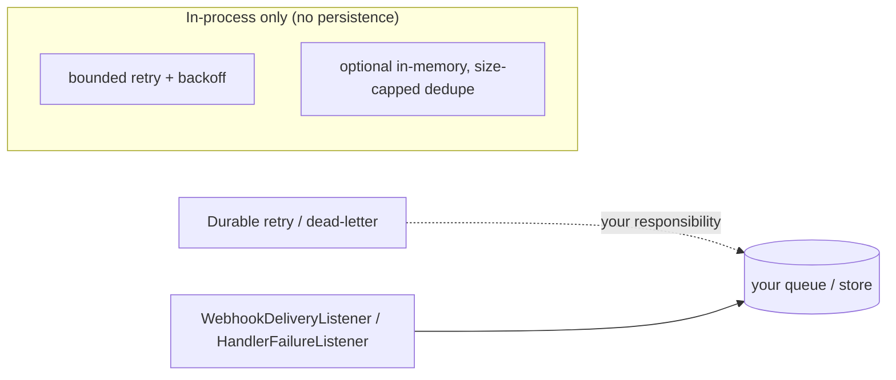

# Architecture

This page gives the mental model: the modules, how a webhook travels through each side, the wire format,
and the single most important design decision — **no storage**.

---

## Modules

The project is a Maven reactor of five library modules: `webhooks-core` plus a starter + autoconfigure
pair for each side. Downstream apps depend on the **starter** artifacts, which transitively bring in the
matching autoconfigure module and its runtime dependencies. The runnable demos live under the separate
`webhooks-sample/` directory (not part of the library reactor) and depend only on the published starters.



| Module | Responsibility |
| --- | --- |
| `webhooks-core` | The shared wire model (`Envelope`, `WebhookHeaders`), the `@WebhookType`/`@Redact` annotations, the `WebhookRedactor`, the `WebhookTypeRegistry`, and the generic `SecretProvider<T>` SPI. Depended on by both sides. |
| `webhooks-consumer-autoconfigure` | The receiver auto-configuration: verification, routing, deserialization, schema validation, dispatch. Added via `webhooks-consumer-starter`. |
| `webhooks-consumer-starter` | Thin Spring Boot starter — the dependency downstream receiver apps add; transitively brings in `webhooks-consumer-autoconfigure` and its runtime deps. |
| `webhooks-producer-autoconfigure` | The annotation-driven sender (`@WebhookClient`) auto-configuration: envelope building, signing, delivery with in-process retry. Added via `webhooks-producer-starter`. |
| `webhooks-producer-starter` | Thin Spring Boot starter — the dependency downstream sender apps add; transitively brings in `webhooks-producer-autoconfigure` and its runtime deps. |
| `webhooks-sample/producer-sample`, `webhooks-sample/consumer-sample` | Two standalone Spring Boot apps (under `webhooks-sample/`, outside the library reactor) demonstrating each side against the published starters. |

The two sides are **independent** — you can depend on just the consumer, just the producer, or both. They
share nothing at runtime; they meet only on the wire.

---

## The wire format

Both sides speak the Standard Webhooks envelope. It is JSON with three top-level fields, delivered with
three signing headers.

```json
{
  "type": "contact.created",
  "timestamp": "2022-11-03T20:26:10.344522Z",
  "data": { "id": "ct_1", "email": "a@b.com" }
}
```

| Header | Meaning |
| --- | --- |
| `webhook-id` | Stable id for this message; the correlation / idempotency key (stable across the sender's retries). |
| `webhook-timestamp` | Unix-seconds time of **this delivery attempt**; signed, and checked against the replay window when enabled. |
| `webhook-signature` | `v1,<base64 HMAC-SHA256>` over `webhook-id.webhook-timestamp.body` (symmetric), or `v2a,<base64 Ed25519>` over `endpoint_id.webhook-id.webhook-timestamp.body` (asymmetric; see [verification & security](guides/verification-and-security.md#asymmetric-signatures-ed25519-v2a)). May carry multiple space-separated signatures during rotation or a scheme migration. |

The envelope-level `timestamp` is the **event-occurrence** time (distinct from the delivery `webhook-timestamp`).
See [STANDARD_WEBHOOKS.md](./reference/STANDARD_WEBHOOKS.md) for the full protocol.

---

## Consumer: the receive pipeline

Every configured path is served by one generic controller. A request flows through verification first, then
routing, then dispatch — and anything that fails verification or routing never reaches your handler.



**Text summary.** The controller resolves the matched endpoint, then
verifies the signature (and optional replay window), optionally de-duplicates, checks the type is known and
accepted, optionally validates the JSON schema, records lags and metrics, then dispatches to your handler
via the configured executor (inline for `sync`, off-thread for `async`). Each failure point returns the
right HTTP status for the sender to act on. See the [Consumer guide](./guides/consumer.md) and
[HTTP status codes](./reference/http-status-codes.md).

---

## Producer: the send pipeline

A `@WebhookClient` method call becomes a signed POST, wrapped in in-process retry.



**Text summary.** The publisher builds the envelope from the event's `@WebhookType`, the signer HMACs it
(dual-signing during secret rotation), and the retrying transport validates the destination URL. Any
`WebhookRequestInterceptor`s then run (the `InterceptingWebhookTransport` layer — e.g. adding an
`Authorization: Bearer` token for transport auth) before the base transport POSTs. The result is classified:
`2xx` is done; a fatal `4xx` is abandoned immediately; a retryable `5xx`/`429`/transport error is retried
with exponential backoff (honoring `Retry-After`) until attempts are exhausted, then abandoned — and because
each retry re-enters the chain at the interceptors, a token-expiry `401` re-mints the token on the next
attempt. Abandoning fires the dead-letter hook and rethrows. See the [Producer guide](./guides/producer.md)
and [Reliability](./guides/reliability.md).

---

## The no-storage design

The single most important thing to understand: **the toolkit holds no state.**

- No delivery history, no attempt log, no retry queue, no idempotency store (by default).
- The producer retries transient failures **in process** (bounded attempts, backoff on the calling thread)
  and then throws — it never spools to disk or a queue.
- The consumer returns the right HTTP status and lets the **sender's** retry be the durability mechanism.



**Text summary.** Retry and optional dedupe are in-memory and bounded, so they never breach no-storage.
Durable, cross-restart retry and dead-lettering are **your** responsibility — the toolkit gives you the
hooks (`WebhookDeliveryListener`, `HandlerFailureListener`) and the send-ready request to persist, but never
holds the state itself.

### Why this matters

- **Stateless scaling.** Any instance can handle any delivery; no shared delivery state to coordinate.
- **No data retention surface.** Nothing sensitive is spooled to disk by the toolkit.
- **Honest acknowledgement.** A `sync` `2xx` means "processed", not "queued" — the sender's retry covers
  the rest. See [Reliability → sync vs async](./guides/reliability.md#sync-vs-async-handling).

The trade-off: there is **no built-in durable retry**. If a delivery must survive a receiver outage beyond
the sender's own retry budget, plug a queue in behind the `WebhookTransport` bean and capture abandons with
the dead-letter hook. See [Reliability](./guides/reliability.md) and the [Runbook](./operations/runbook.md).

---

## Cross-cutting concerns

These apply to both sides and have their own guides:

| Concern | Guide |
| --- | --- |
| Signature verification, replay window, secret rotation, SSRF guard, redaction | [Verification & security](./guides/verification-and-security.md) |
| Retry, `Retry-After`, sync vs async, dead-letter hooks | [Reliability](./guides/reliability.md) |
| Correlation, lag logging, metrics, tracing | [Observability](./guides/observability.md) |
| Replaceable beans / SPIs | [Beans & extension points](./reference/beans-and-spis.md) |
