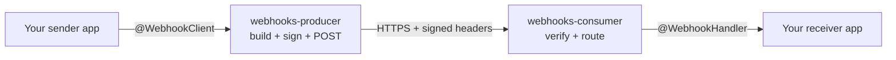
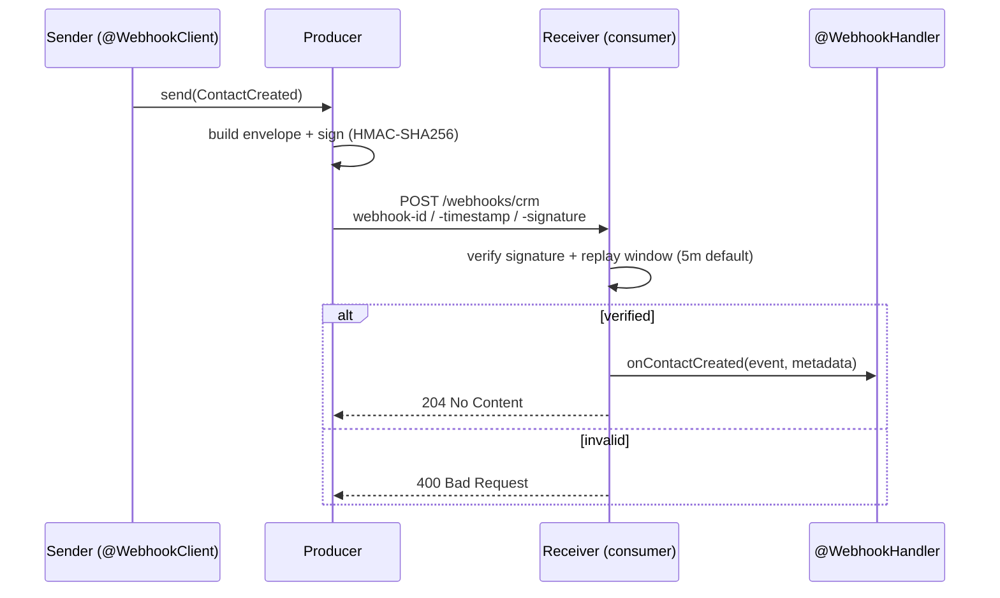

# Getting started

This walkthrough gets a **signed webhook flowing end-to-end** — one service sends it, another verifies and
handles it — in a few minutes. Both sides are drop-in Spring Boot auto-configurations: add a dependency,
add a little config, write a tiny bit of code.

> Prefer to read the design first? See [Architecture](./architecture.md). Want the full config surface?
> See the [Configuration reference](./reference/configuration.md).

---

## The 30-second mental model



**Text summary.** Your sender calls a `@WebhookClient` interface; the producer builds the Standard Webhooks
envelope, signs it, and POSTs it. The consumer on the other side verifies the signature, deserializes the
event, and calls your `@WebhookHandler`. Both are auto-configured; you never wire the plumbing yourself.

---

## 1. Receive a webhook (consumer)

### 1.1 Add the dependency

```xml
<dependency>
  <groupId>io.github.jinternals</groupId>
  <artifactId>webhooks-consumer-starter</artifactId>
  <version>${webhooks.version}</version>
</dependency>
```

No `@EnableWebhooks`, no `@ComponentScan` tweaks — the starter auto-configures on the classpath.

### 1.2 Declare an endpoint and its secret

```yaml
webhooks:
  consumer:
    endpoints:
      - path: /webhooks/crm
        secret: ${CRM_WEBHOOK_SECRET}     # the whsec_... HMAC secret shared with the sender
```

### 1.3 Define the event type

The `@WebhookType` value is the wire `type` string; the class is what the `data` node deserializes into.

```java
import com.jinternals.webhooks.core.annotations.WebhookType;

@WebhookType("contact.created")
public record ContactCreated(String id, String email) { }
```

### 1.4 Write the handler

```java
import com.jinternals.webhooks.consumer.annotations.WebhookHandler;
import com.jinternals.webhooks.consumer.model.WebhookMetadata;
import org.springframework.stereotype.Component;

@Component
public class ContactHandlers {

    @WebhookHandler
    public void onContactCreated(ContactCreated event, WebhookMetadata metadata) {
        // Runs only AFTER signature verification succeeds.
        log.info("New contact {} ({})", event.id(), event.email());
    }
}
```

That's it. A signed POST to `/webhooks/crm` with `{"type":"contact.created","data":{…}}` is verified and
routed to `onContactCreated`. An invalid signature never reaches your handler — it gets a `400`.

> **The `WebhookMetadata` parameter is optional.** Declare it only when you want the `webhook-id`,
> timestamps, lags, or headers; see the [Consumer guide](./guides/consumer.md#handler-signatures).

---

## 2. Send a webhook (producer)

### 2.1 Add the dependency

```xml
<dependency>
  <groupId>io.github.jinternals</groupId>
  <artifactId>webhooks-producer-starter</artifactId>
  <version>${webhooks.version}</version>
</dependency>
```

### 2.2 Declare a named destination

```yaml
webhooks:
  producer:
    destinations:
      crm:
        url: https://partner.example.com/webhooks/crm
        secret: ${CRM_WEBHOOK_SECRET}     # same shared secret the receiver verifies with
```

### 2.3 Declare a `@WebhookClient` and enable clients

```java
import com.jinternals.webhooks.producer.annotations.WebhookClient;

@WebhookClient(destination = "crm")
public interface CrmWebhooks {
    void send(ContactCreated event);      // the @WebhookType on the event picks the wire "type"
}
```

```java
@SpringBootApplication
@EnableWebhookClients(basePackages = "com.example.webhooks")
public class Application { }
```

### 2.4 Inject and call

```java
@Service
public class ContactService {
    private final CrmWebhooks crmWebhooks;

    public ContactService(CrmWebhooks crmWebhooks) {
        this.crmWebhooks = crmWebhooks;
    }

    public void created(Contact c) {
        crmWebhooks.send(new ContactCreated(c.id(), c.email()));
        // The library builds {"type":"contact.created","data":{…}}, signs it, and POSTs it to the
        // "crm" destination — with in-process retry on transient failures.
    }
}
```

---

## 3. What just happened



**Text summary.** The producer turns your typed event into a signed Standard Webhooks envelope and POSTs it.
The consumer verifies the signature and timestamp freshness (`5m` replay window by default), then — only on
success — deserializes and dispatches to your handler, returning `204`. Anything unverified returns `400` and
never reaches your code.

---

## Next steps

- Security & rotation: **[Verification & security](./guides/verification-and-security.md)** (`v1`/`v2a`, replay window, rotation, SSRF, redaction).
- Understand delivery guarantees: **[Reliability](./guides/reliability.md)** (retry, `Retry-After`, sync vs async, dead-letter hooks).
- See it observable: **[Observability](./guides/observability.md)** (correlation, lag logging, metrics).
- Look up any setting: **[Configuration reference](./reference/configuration.md)**.
- Run the bundled demo app: [`webhooks-sample`](../webhooks-sample/README.md).
