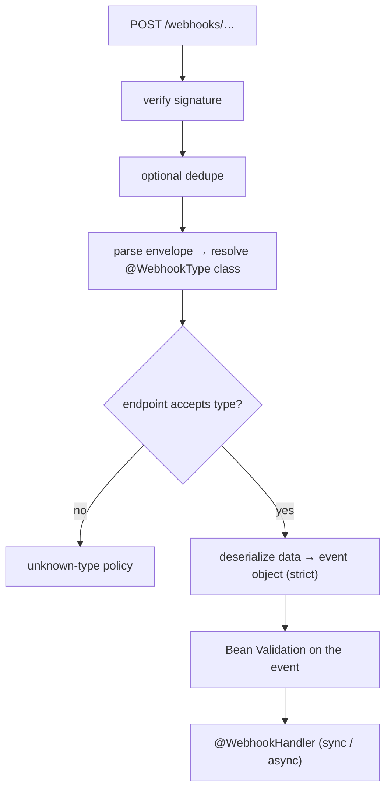
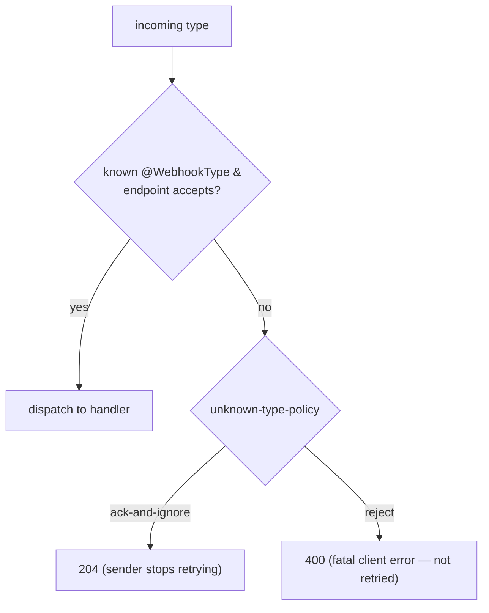

# Consumer guide

How to **receive** webhooks: declare endpoints, model events with `@WebhookType`, handle them with
`@WebhookHandler`, and control routing, payload validation, and the unknown-type policy.

> First time? Do the [Getting started](../getting-started.md#1-receive-a-webhook-consumer) steps, then come
> back here for the detail. For the full property list see the
> [Configuration reference](../reference/configuration.md#consumer-webhooksconsumer).

---

## The receive pipeline



**Text summary.** Verify → (dedupe) → parse envelope → check the type is known and accepted →
deserialize (strict) → validate the event → dispatch. Verification is always first; your handler only
ever sees verified, routed, well-typed, valid events.

---

## Endpoints

An endpoint is a listen path plus the secret used to verify requests to it. Declare one or many.

```yaml
webhooks:
  consumer:
    endpoints:
      - path: /webhooks/crm
        secret: ${CRM_WEBHOOK_SECRET}
```

### One endpoint, many types

Omit `types` to accept **any** known `@WebhookType`; list `types` to restrict the endpoint to an allow-list. This
lets one URL serve several event types, each routed to its own handler:

```yaml
    endpoints:
      - path: /webhooks/crm
        secret: ${CRM_WEBHOOK_SECRET}
        types: [contact.created, contact.updated, contact.deleted]   # allow-list
```

A type outside the list is treated as "unknown for this endpoint" and handled by the
[unknown-type policy](#unknown-type-policy).

---

## Modeling events with `@WebhookType`

The `@WebhookType` value is the wire `type`; the class is what the envelope's `data` node deserializes into. A
record is the natural fit.

```java
@WebhookType("contact.created")
public record ContactCreated(String id, String email) { }
```

- The toolkit scans the host app's `@SpringBootApplication` package(s) once at startup and builds a `type → class` registry; override with a custom `@Bean WebhookTypeRegistry`.
- Exactly one class per `type`; a duplicate `@WebhookType` fails fast at boot.
- Fields you don't declare are **rejected** by the strict event reader (`400`), so adding fields means updating the receiver's `@WebhookType` model first.

See the [Annotations reference](../reference/annotations.md#webhooktype) for the full contract.

---

## Handling events with `@WebhookHandler`

Annotate a method on a Spring bean. The library matches on the **event parameter type**.

```java
@Component
public class ContactHandlers {

    @WebhookHandler
    public void onCreated(ContactCreated event) { … }

    @WebhookHandler
    public void onUpdated(ContactUpdated event) { … }
}
```

### Handler signatures

A handler takes the event, and **optionally** the metadata:

```java
@WebhookHandler
public void onCreated(ContactCreated event, WebhookMetadata metadata) {
    log.info("webhook-id={} deliveryLag={}", metadata.webhookId(), metadata.deliveryLag().orElse(null));
}
```

`WebhookMetadata` carries the `webhook-id`, both timestamps, delivery/event lag, the redacted
headers, the endpoint path, and a `redactedEvent()` that masks `@Redact` fields for safe logging. It does
not carry a trace id — the toolkit writes nothing to the `MDC`; correlation is the app's concern
([SPEC §9b](../reference/SPEC.md#9b-correlation--trace-context-app-owned)). See
[Observability](./observability.md) and the
[Annotations reference](../reference/annotations.md#webhookhandler).

> **Redaction-safe logging.** Mark sensitive event fields with `@Redact`; `metadata.redactedEvent()` masks
> them. Sensitive headers (`webhook-signature`, `authorization`, `proxy-authorization`, `cookie`) are
> redacted from `metadata.headers()` too. See
> [Verification & security → redaction](./verification-and-security.md#redaction-safe-logging).

---

## Unknown-type policy

What happens when a request's `type` has no matching `@WebhookType` class, or is outside an endpoint's allow-list:

| Policy | Behavior | When to use |
| --- | --- | --- |
| `ack-and-ignore` (default) | Return `204` so the sender **stops retrying** an event you don't model. | You subscribe to more types than you handle. |
| `reject` | Return `400`. | You expect to handle every type the sender emits, and want unknowns surfaced. |

```yaml
webhooks:
  consumer:
    unknown-type-policy: ack-and-ignore     # or: reject
```



**Text summary.** A known, accepted type is dispatched. An unknown or disallowed type returns `204` under
`ack-and-ignore` (silent ignore) or `400` under `reject` (surfaces as a visible `4xx` error in sender/receiver
dashboards without triggering `5xx` retry storms).

---

## Per-type payload validation

Validation lives on the event class itself using **Jakarta Bean Validation** — the `@WebhookType` class *is*
the schema. Annotate the fields and the library enforces them on the deserialized event, with no
per-type config:

```java
@WebhookType("invoice.paid")
@Data
public class InvoicePaid {
    @NotBlank private String invoiceId;
    @NotBlank private String customerId;
    @Positive private BigDecimal amount;
    @Size(min = 3, max = 3) private String currency;
}
```

The `data` node is deserialized with a **strict** reader that rejects unknown JSON fields, and every
deserialized event is validated (a class with no constraints trivially passes). A validation failure —
or an unexpected field — returns `400` with an RFC 7807 `ProblemDetail`. See
[HTTP status codes](../reference/http-status-codes.md).

---

## Idempotency (optional, in-memory)

Senders retry, so your handler may see the same `webhook-id` twice. Options, in order of robustness:

1. **Make handlers idempotent** (upsert, dedupe on your own key) — always recommended.
2. **Enable best-effort in-memory dedupe** — a size-capped LRU on `webhook-id`:

   ```yaml
   webhooks:
     consumer:
       in-memory-idempotency: true
       in-memory-idempotency-max-size: 100000
   ```

   This is **per-instance** and **lossy on restart** — it is a cheap guard, not a guarantee.
3. **Plug in a shared store** by replacing the `IdempotencyGuard` bean (e.g. Redis) — see
   [Beans & extension points](../reference/beans-and-spis.md).

---

## Error handling

All failures surface as RFC 7807 `ProblemDetail` responses via a `GlobalExceptionHandler`. The status is
chosen so the **sender** does the right thing (retry a `5xx`, stop on a `4xx`). Full table:
[HTTP status codes](../reference/http-status-codes.md).

---

## Related

- Sync vs async handler execution, and failure hooks → [Reliability](./reliability.md)
- Verification, replay window, secret rotation → [Verification & security](./verification-and-security.md)
- Correlation, lags, metrics → [Observability](./observability.md)
- Every `webhooks.consumer.*` key → [Configuration reference](../reference/configuration.md)
