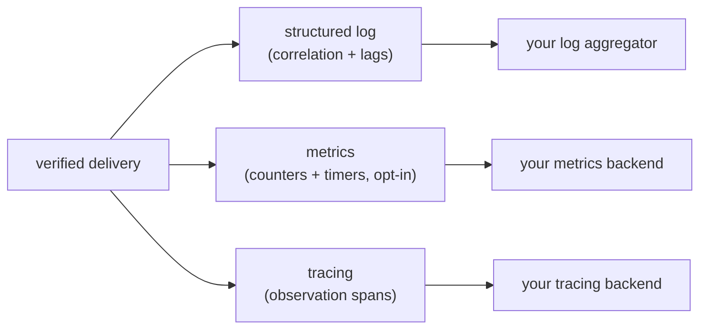
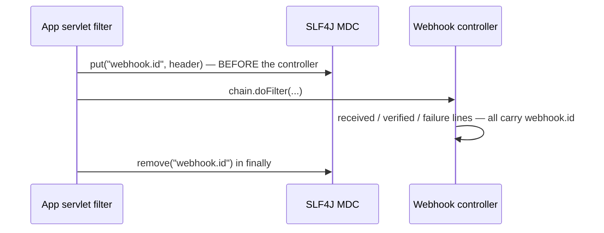
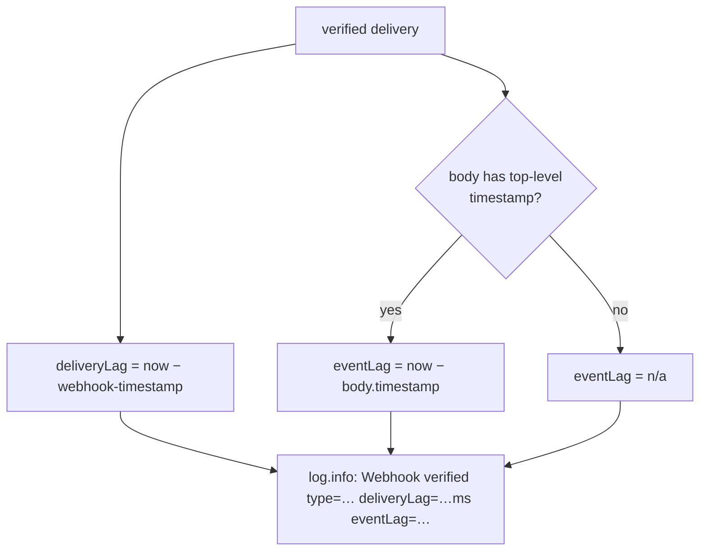
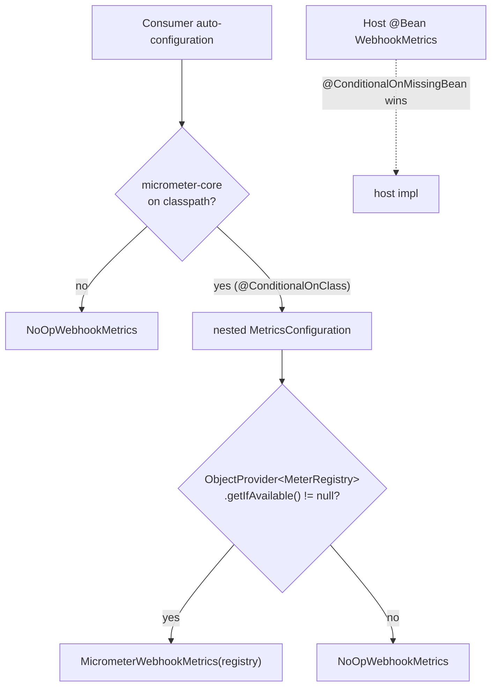

# Observability

How to see what the toolkit is doing in production: structured logging with app-owned `webhook-id`
correlation, delivery/event lag, opt-in Micrometer metrics, and tracing. Everything here is **no-storage**
— it exposes signals, it doesn't retain data.

> For the observation on/off switches and the full design rationale, see
> [SPEC §13](../reference/SPEC.md#13-observability).

---

## The three signals



**Text summary.** Each verified delivery produces a correlated, lag-annotated log line; opt-in Micrometer
meters (when a registry is present); and observation spans for tracing. All three flow to your existing
backends — the toolkit emits, your platform stores.

---

## `webhook-id` correlation (app-owned)

The stable `webhook-id` — the id a sender quotes in support tickets, constant across its retries — is the
right key to correlate the whole delivery history of one event. The toolkit surfaces it on
`WebhookMetadata.webhookId()` for every handler, but it **writes nothing to the SLF4J `MDC` itself**:
correlation and log context are the application's concern
(see [SPEC §9b](../reference/SPEC.md#9b-correlation--trace-context-app-owned)). This keeps a clean
ownership boundary — the toolkit owns the protocol, the app owns observability — and avoids fighting
whatever tracing bridge or logging convention you already run.

To correlate every line of a delivery (including the verification-*failure* line you most want to trace),
bind the `webhook-id` in a servlet filter that runs *before* the webhook controller, and clear it in a
`finally`:



**Text summary.** The application binds the id first, so the received line, any failure line, and the
verified line all carry it; the filter's `finally` removes it so the key never leaks onto an unrelated
request on a pooled thread. The toolkit then propagates this `MDC` across the async handler hop, so the
handler's own log lines stay correlated too. A full, runnable filter lives in the sample consumer app.

Read the id from the `webhook-id` header in the filter, then add the key to your log pattern:

```properties
logging.pattern.level: "%5p [webhook.id=%X{webhook.id}]"
```

Every line then renders as e.g. `INFO  [webhook.id=msg_corr_42] …`.

---

## Delivery lag & event lag

After verification, the consumer logs **one** line with two latencies computed from data already in hand — no
round-trips, no storage:

| Lag | Formula | Meaning |
| --- | --- | --- |
| `deliveryLag` | `now − webhook-timestamp` | age of **this attempt**; grows with the sender's retries |
| `eventLag` | `now − body.timestamp` | age of the **underlying event**; `n/a` if the body carried no timestamp |



**Text summary.** `deliveryLag` is present whenever the request carried a valid `webhook-timestamp` header (mandatory when verification is enabled; `n/a` if omitted while verification is disabled); `eventLag` is
computed from the optional envelope-level `timestamp`, or reported as `n/a`. They differ when a sender retries
(new delivery timestamp) an old event (unchanged body timestamp) — separating *transport* delay from *event*
staleness.

**Example log line:**

```
INFO  [webhook.id=msg_lag_1] Webhook verified type=invoice.paid deliveryLag=3000ms eventLag=...
```

The same two values are available to your handler via `WebhookMetadata`:

```java
@WebhookHandler
public void onPaid(InvoicePaid event, WebhookMetadata metadata) {
    metadata.deliveryLag().ifPresent(lag -> log.info("attempt was {}ms old", lag.toMillis()));
    metadata.eventLag().ifPresent(lag -> log.info("event was {}ms old", lag.toMillis()));
}
```

---

## Opt-in metrics

When the host provides a Micrometer `MeterRegistry` (e.g. via `spring-boot-starter-actuator`), the toolkit
emits the receive-path meters below. With **no** registry it emits nothing — a no-op `WebhookMetrics` keeps
the hot path zero-cost.

| Operation on the receive path | Meter | Type | Tags | Example Prometheus sample |
| --- | --- | --- | --- | --- |
| A verified webhook accepted | `webhook.received` | counter | `type` | `webhook_received_total{type="invoice.paid"} 42` |
| Verification failed | `webhook.verification.failed` | counter | `reason` | `webhook_verification_failed_total{reason="signature"} 3` |
| A handler ran | `webhook.handle.duration` | timer | `type` | `webhook_handle_duration_seconds_max{type="invoice.paid"} 0.031` |
| Delivery lag observed | `webhook.delivery.lag` | distribution summary (ms) | — | `webhook_delivery_lag_max 84.0` |
| Event lag observed | `webhook.event.lag` | distribution summary (ms) | — | `webhook_event_lag_max 1203.0` |

The `reason` tag is a fixed, **low-cardinality** vocabulary, so the registry never sees unbounded tags:
`missing-headers`, `timestamp`, `no-secret`, `signature`, `other`.

### Bean selection — immune to autoconfig ordering



**Text summary.** If `micrometer-core` is absent, the no-op bean is used and the meter code never loads. If
present, the nested `MetricsConfiguration` resolves the registry *when the bean is built* (after every
`MeterRegistry` is registered) and picks Micrometer if one exists, else the no-op. A host `@Bean
WebhookMetrics` overrides both. This ordering-immunity is why the sample's metric-delta assertions pass.

To target any backend, publish your own:

```java
@Bean
WebhookMetrics webhookMetrics(MyBackend backend) {
    return new MyWebhookMetrics(backend);
}
```

---

## Tracing & observations

Both sides wrap their hot path in Micrometer **observations**, so when the host has tracing configured
(Micrometer Tracing + an exporter), each receive and send becomes a span with a `traceId`. The toolkit
does not read or write that `traceId` itself — propagating it into your logs, or across the
producer→consumer boundary, is the application's concern
(see [SPEC §9b](../reference/SPEC.md#9b-correlation--trace-context-app-owned) and the end-to-end example
in the sample apps). Toggle the observations per-side:

```yaml
management:
  observations:
    enable:
      webhook.receive: false   # disable consumer receive metrics + spans
      webhook.send: false      # disable producer send metrics + spans
# Disable all observations:
# management.observations.enable: false
```

See [SPEC §13](../reference/SPEC.md#13-observability) for the full observation design.

---

## What to monitor

| Signal | Watch for | Likely meaning |
| --- | --- | --- |
| `webhook_verification_failed_total{reason="signature"}` rising | misconfigured secret, or an attacker | check rotation state / the sender's secret |
| `webhook_verification_failed_total{reason="timestamp"}` rising | clock skew, or replayed captures | check NTP; confirm replay-window tolerance |
| `webhook_delivery_lag` high | sender is retrying heavily, or you're slow to accept | check receiver throughput / sender health |
| `webhook_handle_duration` high (async) | handlers slow; queue may be filling | scale handlers; watch `CallerRunsPolicy` back-pressure |
| Producer `WebhookDeliveryException` rate | destinations failing | check destination health; inspect dead-letter hook output |

See the [Runbook](../operations/runbook.md) for alert thresholds and response.

---

## Related

- Design rationale → [SPEC §20.6](../reference/SPEC.md#206-spec-alignment-backlog)
- Metadata fields available to handlers → [Annotations → @WebhookHandler](../reference/annotations.md#webhookhandler)
- Operational alerting → [Runbook](../operations/runbook.md)
