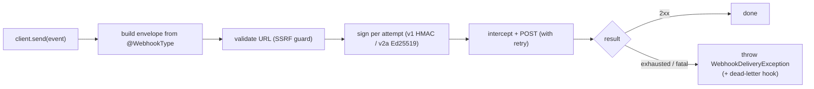

# Producer guide

How to **send** webhooks: declare named destinations, define `@WebhookClient` interfaces, and let the
library build, sign, and deliver the Standard Webhooks envelope with in-process retry.

> First time? Do the [Getting started](../getting-started.md#2-send-a-webhook-producer) steps. For the full
> property list see the [Configuration reference](../reference/configuration.md#producer-webhooksproducer).

---

## The send pipeline



**Text summary.** Your `@WebhookClient` call becomes a typed event → the publisher wraps it in the envelope
(the event's `@WebhookType` supplies the wire `type`) → the URL guard checks the destination once → each
delivery attempt stamps a fresh `webhook-timestamp` + `webhook-signature` (`v1` HMAC or `v2a` Ed25519), runs
any `WebhookRequestInterceptor`s, and POSTs with in-process retry. Success returns normally; a fatal or
exhausted failure throws (and fires the dead-letter hook). See [Reliability](./reliability.md) for the retry detail.

---

## Named destinations

A destination is a URL plus the signing secret shared with the receiver. Name each one; the name is what a
`@WebhookClient` targets.

```yaml
webhooks:
  producer:
    destinations:
      crm:
        url: https://partner.example.com/webhooks/crm
        secret: ${CRM_WEBHOOK_SECRET}
      billing:
        url: https://billing.example.com/webhooks
        secret: ${BILLING_WEBHOOK_SECRET}
```

---

## `@WebhookClient` interfaces

Declare an interface; the library generates the implementation. Each method's **parameter** is a `@WebhookType`
event — its `@WebhookType` value becomes the envelope `type`.

```java
@WebhookClient(destination = "crm")
public interface CrmWebhooks {
    void send(ContactCreated event);
    void send(ContactUpdated event);     // overloads route by the event's @WebhookType
}
```

Enable client scanning once, on a configuration class:

```java
@SpringBootApplication
@EnableWebhookClients(basePackages = "com.example.webhooks")
public class Application { }
```

Then inject and call like any bean:

```java
@Service
public class ContactService {
    private final CrmWebhooks crm;
    ContactService(CrmWebhooks crm) { this.crm = crm; }

    void onCreated(Contact c) {
        crm.send(new ContactCreated(c.id(), c.email()));
    }
}
```

See the [Annotations reference](../reference/annotations.md#webhookclient) for the full contract.

---

## What the library builds

For `crm.send(new ContactCreated("ct_1", "a@b.com"))` the producer POSTs to the `crm` destination:

```
POST https://partner.example.com/webhooks/crm
content-type: application/json
webhook-id: msg_<generated>
webhook-timestamp: 1700000000
webhook-signature: v1,<base64 HMAC-SHA256 over id.timestamp.body>

{"type":"contact.created","timestamp":"…","data":{"id":"ct_1","email":"a@b.com"}}
```

The `webhook-signature` is computed with the destination's secret; during rotation it carries **multiple**
space-separated signatures (see [secret rotation](./verification-and-security.md#secret-rotation)). The
scheme follows the secret's prefix — a `whsec_` secret produces `v1,…` HMAC (shown above), a `whsk_` key
produces `v2a,…` Ed25519 (see [asymmetric signatures](./verification-and-security.md#asymmetric-signatures-ed25519-v2a)).

---

## Delivery guarantees & failure

Delivery is synchronous from the caller's perspective, with **in-process** retry on transient failures:

| Result | Behavior |
| --- | --- |
| `2xx` | Returns normally — delivered. |
| Retryable (`5xx`, `429`, transport error) | Retried with exponential backoff (honors `Retry-After`) up to `max-attempts`, then throws. |
| Fatal (`4xx` other than `429`, or SSRF-blocked URL) | Throws immediately — never retried. |

On the final failure a `WebhookDeliveryException` is thrown to **your** calling code, and the
`WebhookDeliveryListener` dead-letter hook fires once with the send-ready request. The toolkit never spools
the failed delivery itself — durability is your choice. Full detail: [Reliability](./reliability.md).

```java
try {
    crm.send(event);
} catch (WebhookDeliveryException e) {
    // Decide: enqueue for later, alert, drop. The library already tried (retrying transport) and
    // already fired the dead-letter hook; this is your business-level fallback.
}
```

---

## Timeouts & SSRF guard

- **Timeouts** stop a stalled destination from pinning the calling thread
  (`connect-timeout` 5s, `read-timeout` 10s by default). A timeout is retryable.
- **SSRF guard** (`security.allowed-hosts`) is an optional allow-list of destination hosts; off by default
  (hosts come from trusted config). A blocked URL fails fast, before any request.

```yaml
webhooks:
  producer:
    http:
      connect-timeout: 5s
      read-timeout: 10s
    security:
      allowed-hosts: [partner.example.com, billing.example.com]   # empty = no restriction
```

See [Verification & security → SSRF guard](./verification-and-security.md#destination-url-guard-ssrf).

---

## Customizing delivery

Replace any part of the chain with your own `@Bean`:

| Bean | Replace / add to… |
| --- | --- |
| `WebhookRequestInterceptor` (`0..n`, additive) | attach outbound headers per attempt (e.g. `Authorization: Bearer <jwt>`, `x-trace-id`) while keeping built-in retry and SSRF guard. |
| `WebhookTransport` | send asynchronously, through a durable queue (see [Zero-loss queueing](./zero-loss-queueing.md)), or with a different retry policy. |
| `@Bean("webhookProducerRestClient") RestClient` | tune HTTP (proxies, TLS, connection pool); must use bean name `webhookProducerRestClient`. |
| `WebhookSigner` | change the signing scheme. |
| `@Bean("destinationSecretProvider") SecretProvider<Destination>` | resolve secrets from a secrets manager; **must** be named `destinationSecretProvider` so it backs off the default without colliding with the consumer's `SecretProvider<Endpoint>`. |
| `DestinationUrlValidator` | implement a custom outbound-URL policy (CIDR, DNS-rebind blocking). |
| `WebhookDeliveryListener` | capture abandoned deliveries in a dead-letter store. |

See [Beans & extension points](../reference/beans-and-spis.md).

---

## Related

- Retry, backoff, `Retry-After`, dead-letter hooks → [Reliability](./reliability.md)
- Signing, secret rotation, SSRF → [Verification & security](./verification-and-security.md)
- Send-side metrics and tracing → [Observability](./observability.md)
- Every `webhooks.producer.*` key → [Configuration reference](../reference/configuration.md)
