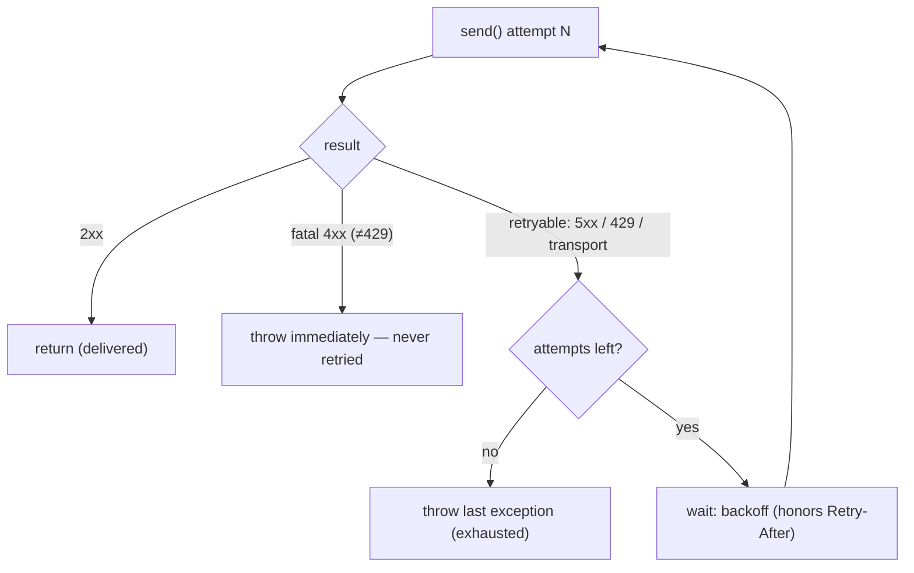
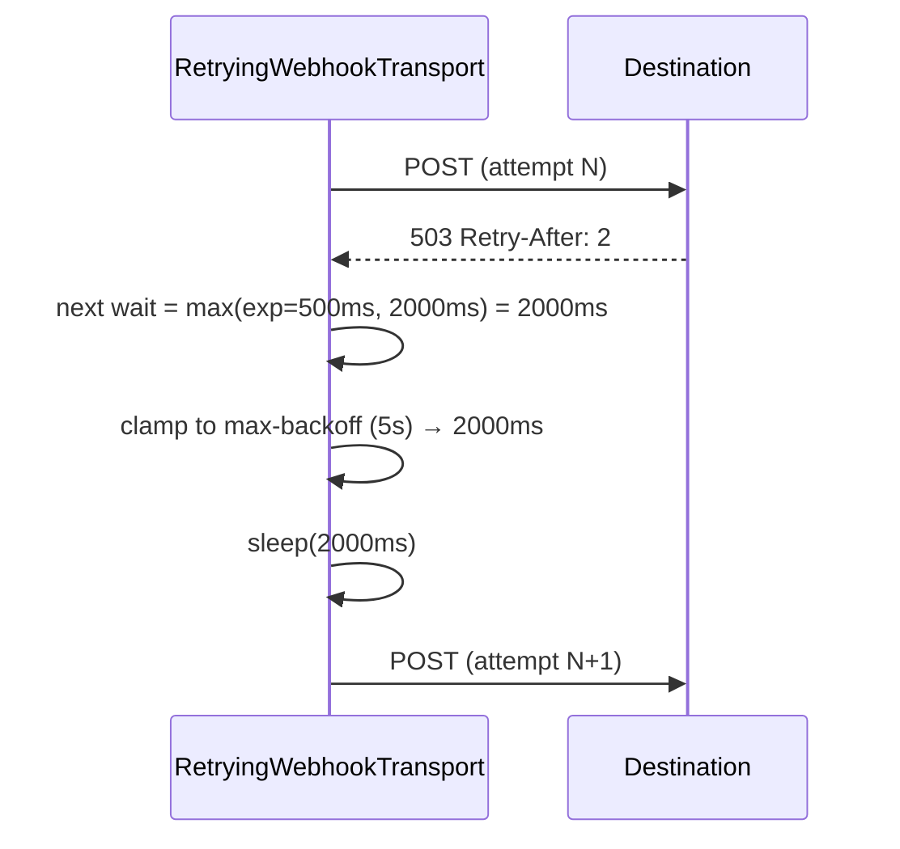
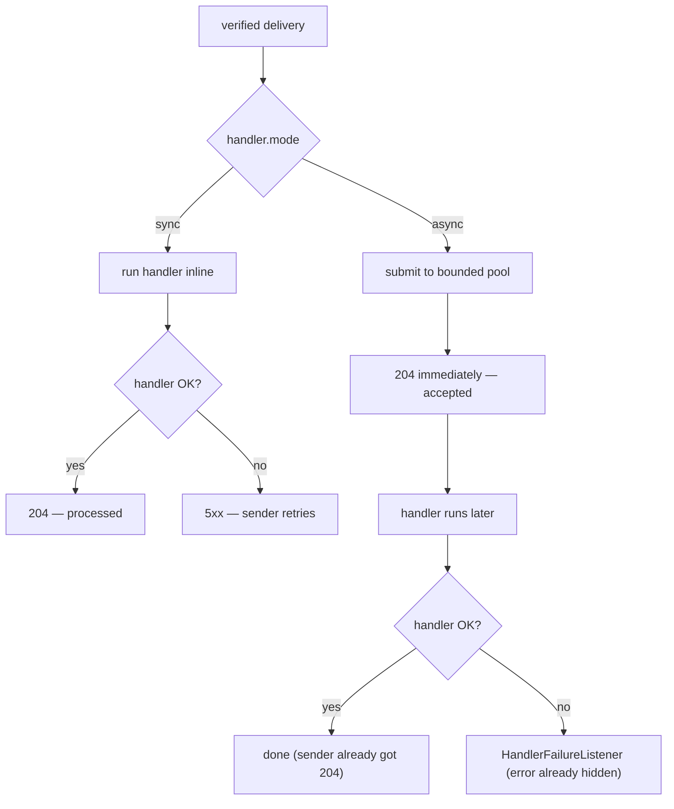
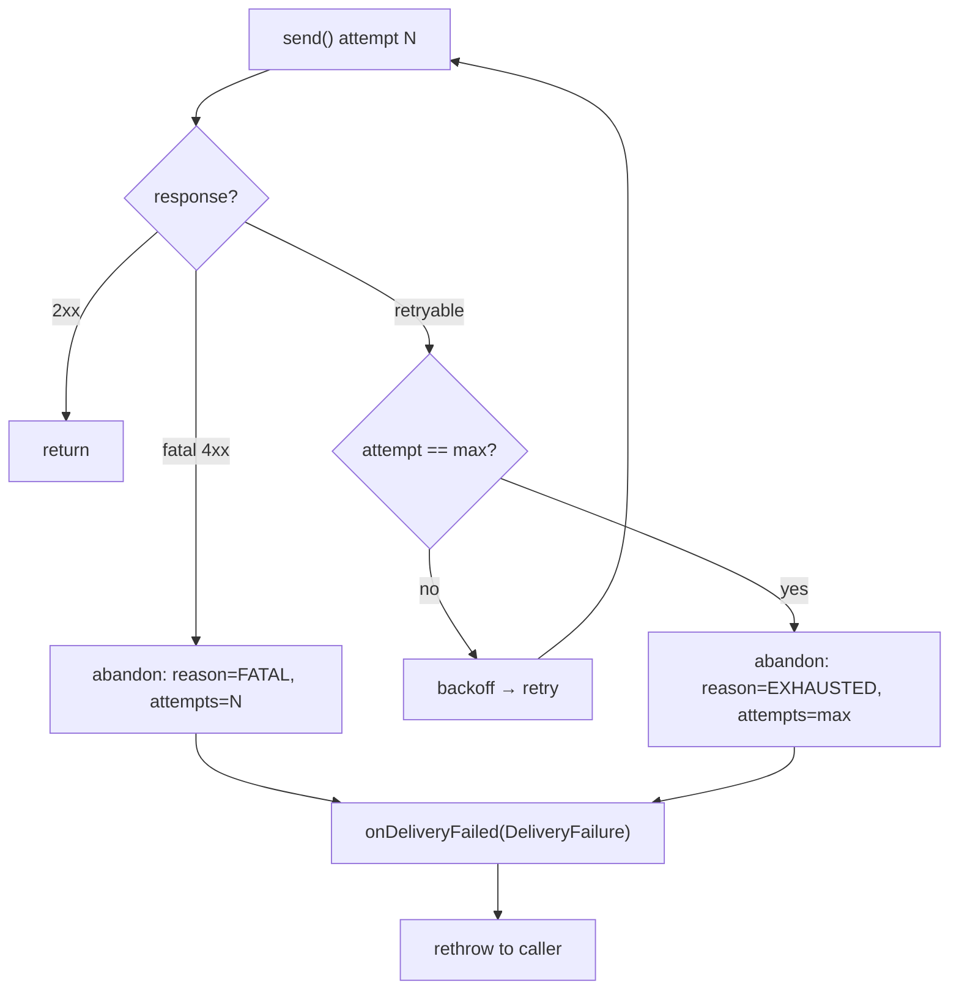
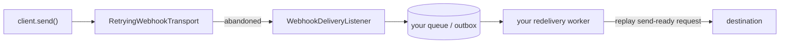

# Reliability

How the toolkit handles failure without storing anything: in-process retry with exponential backoff,
honoring `Retry-After`, the sync-vs-async handler trade-off, and the dead-letter hooks that let you capture
what the toolkit deliberately won't persist.

> The guiding constraint is **no storage** (see [Architecture → no-storage design](../architecture.md#the-no-storage-design)).
> Everything here is in-memory and bounded; durable retry is your responsibility, and the toolkit gives you
> the hooks to build it.

---

## Producer retry & backoff

A `@WebhookClient` call delivers synchronously, retrying **transient** failures in-process before giving up.



**Text summary.** A `2xx` succeeds. A fatal `4xx` (anything but `429`) throws at once and is never retried. A
retryable failure — `5xx`, `429`, or a transport error (timeout, connection refused) — is retried after a
backoff until `max-attempts` is reached, then the last exception is thrown. The wait is a bounded
`Thread.sleep` on the calling thread; nothing is queued or spooled.

### Backoff formula

The wait before attempt *n* is exponential with jitter, capped at `max-backoff`:

```
base   = min(initial-backoff · 2^(n-2), max-backoff)      # n≥2
wait   = uniform( base · (1 − jitter), base )             # jitter randomizes downward
```

| Setting | Default | Meaning |
| --- | --- | --- |
| `max-attempts` | `3` | total attempts incl. the first; `1` disables retry |
| `initial-backoff` | `500ms` | wait before the 2nd attempt; doubles each further attempt |
| `max-backoff` | `5s` | ceiling on any single wait (also the `Retry-After` clamp) |
| `jitter` | `0.5` | fraction of each wait randomized downward, to avoid retry storms |

**Worked example** (defaults, no `Retry-After`): attempt 1 fails → wait ≈ `[250ms, 500ms]` → attempt 2 fails
→ wait ≈ `[500ms, 1000ms]` → attempt 3 fails → throw. Three attempts, two backoffs.

```yaml
webhooks:
  producer:
    retry:
      max-attempts: 3
      initial-backoff: 500ms
      max-backoff: 5s
      jitter: 0.5
```

---

## Honoring `Retry-After`

When a retryable response (`429` / `503`) carries a `Retry-After` header, the producer uses it as a **backoff
floor**: the next wait is `max(exponential, Retry-After)`, with `Retry-After` itself clamped to `max-backoff`
so an over-eager server can never push a wait past the ceiling.



**Text summary.** The base transport parses `Retry-After` (both the delta-seconds and HTTP-date forms) onto
`WebhookDeliveryException.getRetryAfter()`; the retrying layer takes `max(exponential, Retry-After)`, clamps
to `max-backoff`, and sleeps that long. It only ever *raises* a wait, never lowers it, so it is always safe —
there is no flag to disable it.

| Server response | Exponential | `Retry-After` (clamped) | Effective wait |
| --- | --- | --- | --- |
| `503`, no header | 500ms | — | **500ms** |
| `503 Retry-After: 2` | 500ms | 2000ms | **2000ms** (floor wins) |
| `429 Retry-After: 0` | 500ms | 0ms | **500ms** (floor below exp) |
| `503 Retry-After: 3600` | 500ms | 5000ms (clamped) | **5000ms** (ceiling) |

Both RFC 7231 header forms are parsed (in `RestClientWebhookTransport.parseRetryAfter`), with anything
unusable falling back to pure exponential backoff:

| Header value | Interpreted as | Notes |
| --- | --- | --- |
| `Retry-After: 120` | `Duration.ofSeconds(120)` | delta-seconds — the common form |
| `Retry-After: -5` | `Duration.ZERO` | a negative delta clamps to zero (never a negative sleep) |
| `Retry-After: Wed, 21 Oct 2015 07:28:00 GMT` | `now − date`, or `ZERO` if past | RFC 1123 HTTP-date |
| `Retry-After: soon` | ignored | unparseable → pure exponential backoff |
| *(absent)* | ignored | pure exponential backoff |

---

## Sync vs async handling

On the **consumer**, how your `@WebhookHandler` runs changes what a `2xx` *means*.



**Text summary.** In `sync` mode the handler runs inline: success returns `204` ("processed"), a thrown
handler becomes a `5xx` the sender retries. In `async` mode the controller returns `204` ("accepted")
*before* the handler runs on a bounded pool; a later failure can't change the already-sent `204`, so it is
logged at `ERROR` and routed to the `HandlerFailureListener`.

| | `sync` (default) | `async` |
| --- | --- | --- |
| `2xx` means | **processed** | **accepted** (not yet processed) |
| Slow handler | holds the sender's connection | returns fast, runs off-thread |
| Handler throws | `5xx` → sender retries | `204` already sent → `HandlerFailureListener` |
| Crash before handler runs | delivery not acked (sender retries) | **delivery lost** (was already acked) |
| Use when | handlers are fast; you want sender-retry durability | handlers are slow and sender timeout is tight |

```yaml
webhooks:
  consumer:
    handler:
      mode: sync           # or: async
      core-pool-size: 4    # async only
      max-pool-size: 16
      queue-capacity: 1000 # full queue → CallerRunsPolicy back-pressure
      timeout: 30s         # async per-handler timeout → interrupt + onHandlerTimeout
```

> **Prefer `sync` unless you have a reason not to.** It makes the sender's retry your durability mechanism:
> if you can't process it, you don't ack it, and the sender tries again. `async` trades that away for latency
> — a crash after the `204` but before the handler drops the delivery.

---

## Dead-letter failure hooks

The toolkit stores nothing, but it never lets a failure vanish. Two **no-op-by-default** listener SPIs give
you one place to capture a failure — persist, alert, or enqueue for replay. Both are
`@ConditionalOnMissingBean`, so publishing your own `@Bean` replaces the no-op.

| Hook | Side | Fires when |
| --- | --- | --- |
| `WebhookDeliveryListener` | Producer | an outbound delivery is **abandoned** — fatal `4xx`, or retries exhausted |
| `HandlerFailureListener` | Consumer | an **async** handler throws or times out (the `204` already hid it) |

### Producer hook — `WebhookDeliveryListener`



**Text summary.** A fatal `4xx` abandons immediately (`reason=FATAL`, `attempts=1`); a retryable failure
retries to `max-attempts` then abandons (`reason=EXHAUSTED`). Either way `onDeliveryFailed` fires **once**
with a `DeliveryFailure` carrying the send-ready signed request, the attempt count, and the last cause — then
the exception is rethrown.

```java
@Bean
WebhookDeliveryListener deadLetter(MyDeadLetterStore store) {
    return failure -> store.save(failure.url(), failure.headers(), failure.body(),
                                 failure.attempts(), failure.cause());   // send-ready → replayable
}
```

| Operation | `DeliveryFailure` fields |
| --- | --- |
| Destination returns a fatal `4xx` (e.g. `404`) | `reason = FATAL`, `attempts = 1` |
| Destination returns `503` until `max-attempts` spent | `reason = EXHAUSTED`, `attempts = max-attempts` |

### Consumer hook — `HandlerFailureListener`

In `sync` mode a thrown handler becomes the non-`2xx` the sender retries on — nothing is hidden. In `async`
mode the `204` was already sent, so a failure would otherwise be invisible; the executor logs it at `ERROR`
**and** routes it here.

| Operation | Hook method |
| --- | --- |
| `async` handler throws | `onHandlerFailed(type, cause)` |
| `async` handler exceeds `timeout` | `onHandlerTimeout(type)` |

### Isolation guarantee

Both hooks are isolated: a listener that itself throws is caught and logged and **cannot** change the
outcome — the producer still rethrows, the async executor still moves on. A down dead-letter sink never turns
one failure into two.

---

## Building durable delivery on top

The toolkit's retry is in-process and bounded; for delivery that survives a receiver outage beyond the
sender's retry budget, plug durability in behind the hooks:



**Text summary.** Let the in-process retry handle transient blips; capture abandons via
`WebhookDeliveryListener` into your own queue/outbox, and run your own worker to replay — or replace
`WebhookTransport` on the producer **and** persist verified events to a durable inbox before returning `204`
on the consumer for **end-to-end zero webhook loss** (remembering to refresh `webhook-timestamp` and
`webhook-signature` on delayed retries so the consumer's `5m` replay window accepts them!). A complete
runnable NATS JetStream implementation for both producer and consumer is documented in
**[Zero-webhook-loss queueing](./zero-loss-queueing.md)** (`producer-nats-sample` + `consumer-nats-sample`).
See the [Runbook](../operations/runbook.md) for operational patterns.

---

## Related

- Where retry sits in the pipeline → [Architecture](../architecture.md#producer-the-send-pipeline)
- Design rationale → [SPEC §20.6](../reference/SPEC.md#206-spec-alignment-backlog)
- Producer/handler config keys → [Configuration reference](../reference/configuration.md)
- Replacing the transport → [Beans & extension points](../reference/beans-and-spis.md)
