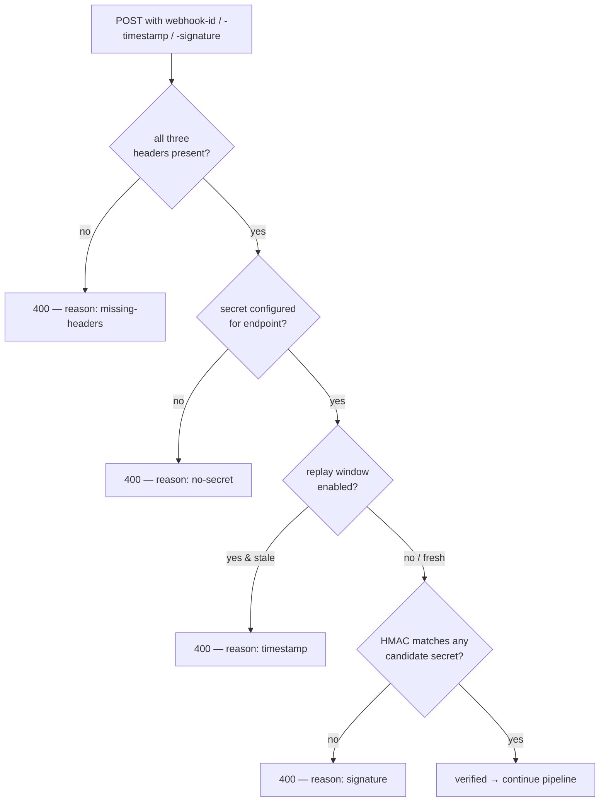
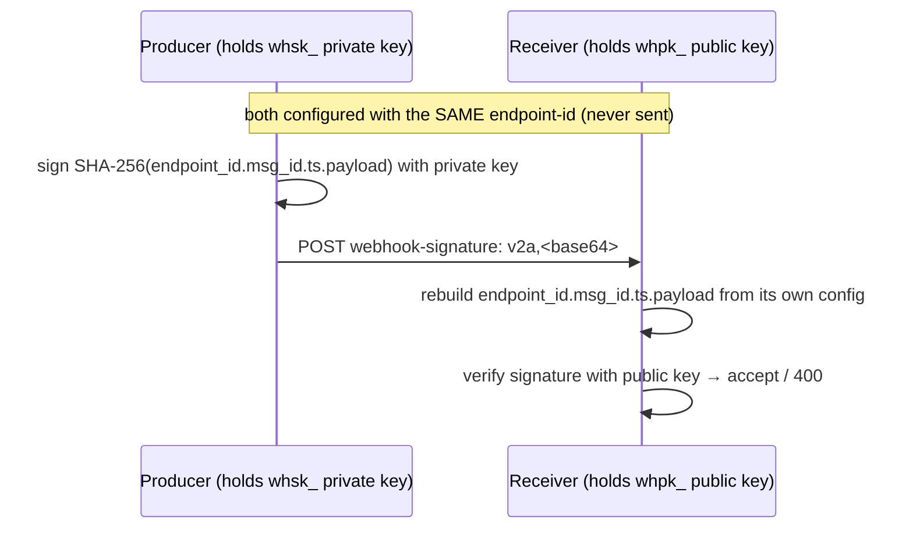
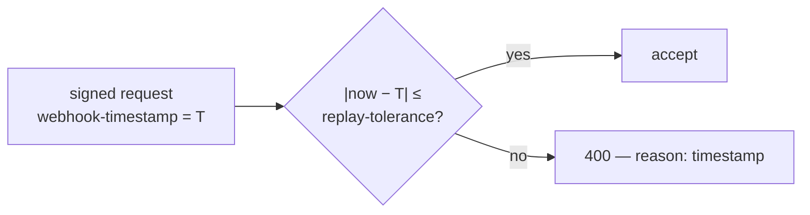
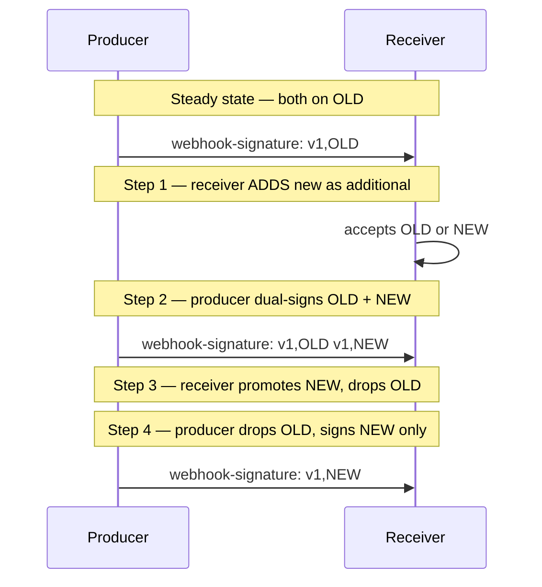
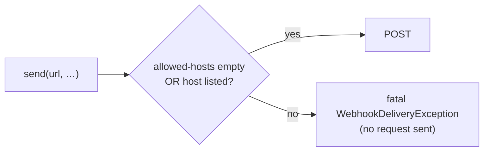
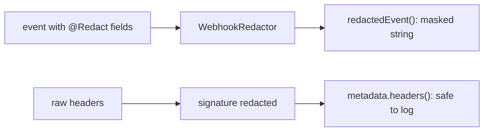

# Verification & security

How the toolkit keeps webhooks trustworthy: signature verification (symmetric HMAC `v1` and asymmetric
Ed25519 `v2a`), the optional replay window, zero-downtime secret rotation, the outbound SSRF guard, and
redaction-safe logging. These concerns apply to both sides — the producer signs, the consumer verifies.

> For the protocol-level detail (exact signing string, header formats) see
> [`STANDARD_WEBHOOKS.md`](../reference/STANDARD_WEBHOOKS.md). For every property mentioned here see the
> [Configuration reference](../reference/configuration.md).

---

## Signature verification

Every inbound request is verified **before** anything else happens — before deserialization, before your
handler, before any logging of the body. An unverified request never reaches your code.

The default signature is `v1,<base64 HMAC-SHA256>` computed over the exact string
`webhook-id.webhook-timestamp.body` using the endpoint's secret. The consumer recomputes it over the **raw**
received bytes and compares in constant time. The scheme is chosen **per secret, by prefix** — a `whsec_`
secret uses symmetric `v1` HMAC, a `whpk_` public key uses asymmetric `v2a` Ed25519
([below](#asymmetric-signatures-ed25519-v2a)) — so an endpoint can verify either, or both during a migration,
with no extra flag.



**Text summary.** Verification checks, in order: all three signing headers present; a secret exists for the
matched endpoint; (if the replay window is enabled) the timestamp is fresh; and the recomputed HMAC matches
the primary secret or any rotation secret. The first failure returns `400` with a low-cardinality `reason`
tag (`missing-headers`, `no-secret`, `timestamp`, `signature`) used by the metrics. See
[Observability → metrics](./observability.md#opt-in-metrics).

### Why verification is first

The raw body is verified against the signature **before** it is parsed or logged. A forged or tampered body
fails the HMAC check and is rejected with `400` — your deserialization, schema validation, and handler code
only ever run on authentic payloads. This is also why the body-size limit (`max-body-size`, default 256 KB)
is enforced *before* verification: an oversized POST is rejected with `413` without reading it all into
memory.

---

## Asymmetric signatures (Ed25519 `v2a`)

The default `v1` scheme is **symmetric**: the same `whsec_` secret both signs (producer) and verifies
(consumer). That means a compromised receiver can forge deliveries that look authentic. The **asymmetric**
`v2a` scheme removes that risk — the producer signs with an Ed25519 **private** key and the consumer
verifies with only the matching **public** key, so the receiver can check authenticity but can never produce
a valid signature.

Use `v2a` when the two sides are in different trust domains (e.g. you send to a third party, or receive from
one) and you don't want the receiver to hold a secret capable of impersonating the sender. Everything else —
the three headers, the replay window, rotation, dual-signing — works exactly as for `v1`.

### What changes vs `v1`

| | `v1` (symmetric) | `v2a` (asymmetric) |
| --- | --- | --- |
| Producer secret | `whsec_` HMAC secret | `whsk_` Ed25519 **private** key |
| Consumer secret | the **same** `whsec_` secret | `whpk_` Ed25519 **public** key (the producer's public half) |
| Signed content | `msg_id.timestamp.payload` | `endpoint_id.msg_id.timestamp.payload` |
| Extra config | — | an `endpoint-id`, identical on both sides |
| Header | `v1,<base64>` | `v2a,<base64>` (space-separated alongside any `v1,…`) |

The signature is `v2a,base64(ed25519_sign(privateKey, SHA-256(endpoint_id.msg_id.timestamp.payload)))`.

### Why the `endpoint-id` is required

With symmetric `v1`, every endpoint has its **own** secret, so a signature is implicitly bound to that one
endpoint — no other endpoint knows the secret, so the signature can't verify anywhere else. Asymmetric `v2a`
breaks that assumption: the verifying material is a **public** key, which is *not* a secret and is routinely
**reused across many endpoints or customers** (that's a large part of the point — one key pair, many
receivers). That reuse opens a gap the `endpoint-id` closes:

- **Prevents cross-endpoint replay.** Suppose a producer signs deliveries for both endpoint A and endpoint B
  with the same key pair, and B trusts the same public key as A. Without a binding, a genuine, correctly
  signed delivery meant for A could be **captured and re-posted to B** — the signature would still verify,
  because it's the same key. Mixing the `endpoint-id` into the signed content makes the signature valid for
  **only** the endpoint it was made for: A's signature was computed over `A.msg_id.ts.payload`, so it fails
  at B, which rebuilds and checks `B.msg_id.ts.payload`.
- **Lets one key pair safely serve many endpoints.** Because the id is what distinguishes them, you don't
  need a separate key per endpoint to stay isolated — the shared public key plus a distinct `endpoint-id`
  per endpoint is enough.

The `endpoint-id` is **never sent on the wire**. Each side rebuilds the signed content from its *own
configured* value, so an attacker can't just change an id in the request to make a signature match — there is
no id in the request to change. That's also why both sides must be configured with the **same** value out of
band: it's part of the signature, not part of the message.

> This is the asymmetric counterpart of the per-endpoint secret in `v1`. It is **not** a replacement for the
> [replay window](#replay-window) — the `endpoint-id` stops a delivery from being replayed *to a different
> endpoint*; the replay window stops a delivery from being replayed *to the same endpoint later*. Use both
> for internet-facing `v2a` endpoints.

### Setup — exactly what to configure on each side

**1. Generate an Ed25519 key pair.** Use any Standard Webhooks SDK to produce a `whsk_`/`whpk_` pair (the
value after the prefix is the Base64 of the raw 32-byte key). Keep the `whsk_` private key on the **producer**
only; give the `whpk_` public key to the **receiver**. They are interoperable with any conforming sender or
SDK.

**2. Pick a stable `endpoint-id`** — any identifier **without a `.`** (that character is the signed-content
delimiter), e.g. `ep_2fVZdC8Kx9TR4ZoCqHWt3NnLgRb`. Both sides must use the **same** value for the same
destination/endpoint.

**3. Configure the producer** — the private key plus the endpoint-id, per destination:

```yaml
webhooks:
  producer:
    destinations:
      crm:
        url: https://partner.example.com/webhooks/crm
        endpoint-id: ep_2fVZdC8Kx9TR4ZoCqHWt3NnLgRb    # required; must not contain '.'
        secret: ${CRM_WEBHOOK_PRIVATE_KEY}             # whsk_… — never share this
```

**4. Configure the consumer** — the matching public key plus the **same** endpoint-id, per endpoint:

```yaml
webhooks:
  consumer:
    endpoints:
      - path: /webhooks/crm
        endpoint-id: ep_2fVZdC8Kx9TR4ZoCqHWt3NnLgRb    # must match the producer exactly
        secret: ${CRM_WEBHOOK_PUBLIC_KEY}              # whpk_… the producer shared with you
```

That's it. The producer sees the `whsk_` prefix and signs `v2a`; the consumer sees the `whpk_` prefix and
verifies `v2a`. No code changes and no extra flag.



### Fan-out, rotation, and migration

- **One producer → many receivers (fan-out).** Each `destination` carries its own `endpoint-id` and key.
  Two destinations may share a key pair by repeating the same `whsk_` value; keep the `endpoint-id`s
  distinct so a signature for one receiver can't verify at another.
- **One path ← many *independent* producers.** Out of scope for the scheme — configure **one endpoint per
  producer** (each with its own `endpoint-id` and that producer's public key) rather than multiplexing one
  endpoint across senders.
- **Rotation.** The same blue/green dance as `v1` ([below](#secret-rotation)) with two `whsk_`/`whpk_` keys
  in `additional-secrets` — the producer dual-signs, the receiver trusts both, then each side retires the old
  key.
- **Migrating `v1 → v2a`.** Put both a `whsec_` and the new `whsk_`/`whpk_` key in `secret` +
  `additional-secrets`. The producer dual-signs `v1,… v2a,…`; the receiver accepts whichever it can verify,
  so you can cut over at your own pace, then drop the `whsec_` secret.

### If it's misconfigured, it fails at startup

Both sides validate `v2a` material when the context starts (not on the first request) and render a clean
`APPLICATION FAILED TO START` report — never the key material — naming the target and the fix:

- a `whsk_`/`whpk_` key present with **no `endpoint-id`**;
- an `endpoint-id` containing a `.`;
- a malformed key (doesn't decode to a 32-byte Ed25519 key);
- the **wrong half** of the pair — a `whpk_` public key on the producer, or a `whsk_` private key on the
  consumer;
- an `endpoint-id` set on a purely `v1` target is accepted but **warns** that it will be ignored.

See [SPEC §8e](../reference/SPEC.md#8e-asymmetric-verification--ed25519-v2a-whpk_) (consumer) and
[§19i](../reference/SPEC.md#19i-asymmetric-signing--ed25519-v2a-whsk_) (producer) for the full contract.

---

## Disabling signing / verification

Message signing (producer) and signature verification (consumer) can each be turned off **independently**.
Both are **on by default** and the two sides are unrelated flags — turning one off has no effect on the other.

```yaml
# producer: stop adding the webhook-signature header
webhooks:
  producer:
    signing-enabled: false     # sends deliveries UNSIGNED; no destination secret required

# consumer: stop checking the webhook-signature header
webhooks:
  consumer:
    signature-verification-enabled: false   # accepts EVERY request; no endpoint secret required
```

### Disabling signing

With `webhooks.producer.signing-enabled=false` the producer wires the no-op signer: deliveries carry **no**
`webhook-signature` header and **no signing secret is required** on any destination. This is message
authentication removed — a receiver that verifies signatures will reject the unsigned deliveries.

### Disabling verification

With `webhooks.consumer.signature-verification-enabled=false` the consumer wires the no-op verifier: **every**
inbound request is accepted without checking its signature, **no endpoint secret is required**, and
`validate-secrets-on-startup` is skipped. A prominent `SECURITY: … DISABLED …` **WARN is logged at every
startup** so the state is never silent.

> **Security note.** Disabling either side removes the message-authentication layer. An endpoint with
> verification off accepts forged payloads from anyone who can reach it. Only disable when authenticity is
> guaranteed by the **transport** instead — mutual TLS, an authenticating reverse proxy, or (on the consumer)
> a Spring Security resource-server chain in front of the endpoint, paired with producer
> [transport authentication](./transport-authentication.md). Message signing and transport auth are
> complementary; prefer keeping both. See [SPEC §8f](../reference/SPEC.md#8f-disabling-message-security) /
> [§19h](../reference/SPEC.md#19h-disabling-message-signing).

To switch between the built-in schemes, just change the secret's prefix — `whsec_` for `v1`, `whsk_`/`whpk_`
for `v2a` ([above](#asymmetric-signatures-ed25519-v2a)). For a scheme that isn't built in, publish your own
`WebhookSigner` / `WebhookVerifier` bean — see [Beans & extension points](../reference/beans-and-spis.md).

---

## Replay window

A correctly-signed request captured off the wire can be **replayed** verbatim by an attacker — the signature
is still valid. The replay window defends against this by rejecting requests whose `webhook-timestamp` is too
far from the server clock.



**Text summary.** When enabled, a request is accepted only if its timestamp is within `replay-tolerance`
(default 5 minutes) of the server clock, in either direction. A replayed capture falls outside the window
once the tolerance elapses and is rejected.

```yaml
webhooks:
  consumer:
    replay-window-enabled: true      # ENABLED by default
    replay-tolerance: 5m             # |now − webhook-timestamp| must be ≤ this
```

> **Enabled by default.** Out of the box, `ClockSkewTimestampValidator` rejects captured deliveries
> outside `replay-tolerance` (`5m`). Keep clocks in NTP sync and pair it with idempotent handlers (a
> legitimate retry within the window is still a duplicate). Only set `replay-window-enabled: false`
> when replaying historical fixtures or behind an asynchronous store-and-forward queue that does not
> refresh `webhook-timestamp`. See [SPEC §8b](../reference/SPEC.md#8b-replay-window-timestamp-freshness).

| Trade-off | Window **on** (default) | Window **off** (`false`) |
| --- | --- | --- |
| Replay resistance | bounded to `replay-tolerance` | none — signature trusted forever |
| Clock requirement | sender & receiver within tolerance | none |
| Best for | production & internet-facing endpoints | offline fixture replay |

---

## Secret rotation

You can roll a secret with **zero downtime** on both sides — no window where deliveries fail — using
additional secrets.

### Consumer side — accept old *and* new

List the incoming secret under `additional-secrets`; a signature made with the primary **or** any additional
secret verifies.

```yaml
webhooks:
  consumer:
    endpoints:
      - path: /webhooks/crm
        secret: ${CRM_SECRET_NEW}             # the one you're moving to
        additional-secrets:
          - ${CRM_SECRET_OLD}                 # still accepted during the window
```

### Producer side — sign with old *and* new (dual-sign)

List the extra secret under the destination's `additional-secrets`; the producer **dual-signs** — it signs
the identical payload with every secret and sends all signatures space-separated in one `webhook-signature`
header. A receiver that trusts *either* secret verifies.

```yaml
webhooks:
  producer:
    destinations:
      crm:
        url: https://partner.example.com/webhooks/crm
        secret: ${CRM_SECRET_NEW}
        additional-secrets:
          - ${CRM_SECRET_OLD}
```

### The rotation sequence



**Text summary.** Add the new secret as an *additional* secret on the receiver first (now it accepts old or
new), then have the producer dual-sign old+new (every delivery verifies either way), then promote new to
primary and drop old on the receiver, and finally drop old on the producer. At no point does a valid delivery
fail. See [SPEC §8a](../reference/SPEC.md#8a-secret-source--rotation-secretprovider) / [§19a](../reference/SPEC.md#19a-secret-rotation-bluegreen).

| Operation | `webhook-signature` sent | Receiver accepts if it knows… |
| --- | --- | --- |
| Pre-rotation | `v1,OLD` | OLD |
| During (dual-sign) | `v1,OLD v1,NEW` | OLD **or** NEW |
| Post-rotation | `v1,NEW` | NEW |

---

## Destination URL guard (SSRF)

On the **producer**, destinations come from trusted config, but if a URL is ever derived from less-trusted
input you can restrict outbound deliveries to an explicit host allow-list. A blocked host fails fast, before
any connection — a webhook delivery must never become a server-side request forgery into your own network.

```yaml
webhooks:
  producer:
    security:
      allowed-hosts: [partner.example.com, billing.example.com]   # empty = no restriction (default)
```



**Text summary.** With `allowed-hosts` empty (default), any destination is permitted. When populated, only
those exact hosts may be delivered to; anything else throws a fatal `WebhookDeliveryException` before a
socket is opened. For stronger policies (CIDR blocks, DNS-rebind protection) replace the
`DestinationUrlValidator` bean — see [Beans & extension points](../reference/beans-and-spis.md).

---

## Redaction-safe logging

Webhook payloads often carry PII or secrets. Two mechanisms keep them out of your logs:

1. **`@Redact` on event fields.** Mark sensitive fields; `metadata.redactedEvent()` returns a string with
   them masked, safe to log.

   ```java
   @WebhookType("contact.created")
   public record ContactCreated(String id, @Redact String email, @Redact String ssn) { }
   ```

   ```java
   @WebhookHandler
   public void onCreated(ContactCreated event, WebhookMetadata metadata) {
       log.info("received {}", metadata.redactedEvent());   // email & ssn masked
       // NEVER log event.toString() directly — that leaks the raw fields.
   }
   ```

2. **Signature redaction in headers.** `metadata.headers()` has `webhook-signature` redacted, and the signing
   secret is never placed in metadata at all — so logging the header map can't leak signing material.



**Text summary.** `@Redact` fields are masked by the `WebhookRedactor` behind `metadata.redactedEvent()`,
and the signature header is stripped from `metadata.headers()`. Log those, never the raw event or raw
headers. See [SPEC §9a](../reference/SPEC.md#9a-field-level-redaction--redact) and the
[Annotations reference](../reference/annotations.md#redact).

---

## Security checklist

| Control | Default | Recommendation |
| --- | --- | --- |
| Signature verification | on (`v1` HMAC) | on by default; use `v2a` (Ed25519) across trust boundaries so the receiver can't forge deliveries |
| Replay window | **off** | **on** for internet-facing endpoints, with NTP-synced clocks |
| Secret storage | from config / `${ENV}` | inject via env or a secrets manager; never commit secrets |
| Secret rotation | manual | use `additional-secrets` for zero-downtime rolls |
| Body-size limit | 256 KB | lower if your events are small; blocks memory-exhaustion |
| SSRF guard | off (no restriction) | populate `allowed-hosts` if destinations are ever semi-trusted |
| Startup secret validation | on | leave on — fails fast instead of per-request `500`s |
| Redaction | opt-in via `@Redact` | mark every PII/secret field; log `redactedEvent()` only |

---

## Related

- Full protocol: [`STANDARD_WEBHOOKS.md`](../reference/STANDARD_WEBHOOKS.md)
- Status codes for each failure: [HTTP status codes](../reference/http-status-codes.md)
- Replaceable security beans: [Beans & extension points](../reference/beans-and-spis.md)
- Every security-related key: [Configuration reference](../reference/configuration.md)
