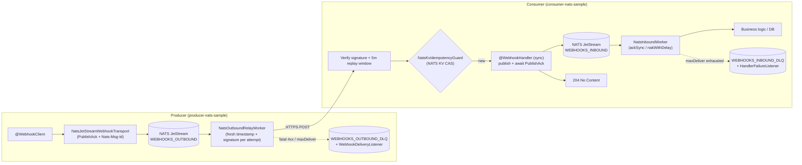

# Zero-webhook-loss queueing (NATS JetStream)

The core Webhooks Toolkit libraries hold **no storage** by design — they stay lightweight, stateless, and
dependency-free. When your business requires **zero webhook loss** across JVM restarts, downstream database
outages, and multi-hour receiver downtime, you layer a durable broker behind the toolkit's SPIs on **both**
sides.

A complete, runnable implementation using **NATS JetStream** and **NATS KeyValue** lives in
[`webhooks-sample/producer-nats-sample`](../../webhooks-sample/producer-nats-sample) and
[`webhooks-sample/consumer-nats-sample`](../../webhooks-sample/consumer-nats-sample) (with
[`docker-compose.nats.yml`](../../webhooks-sample/docker-compose.nats.yml)).

---

## End-to-end architecture



**Text summary.** Neither side acknowledges work while it lives only in volatile memory:

1. **Producer:** `@WebhookClient` calls `NatsJetStreamWebhookTransport` (`WebhookTransport` SPI), which
   persists `(url, webhookId, body, traceId)` to `WEBHOOKS_OUTBOUND` with `Nats-Msg-Id = webhook-id` and
   returns only after NATS confirms `PublishAck`. `NatsOutboundRelayWorker` pulls messages, computes a
   **fresh `webhook-timestamp` and `webhook-signature` on every attempt**, and POSTs to the destination.
2. **Consumer:** Runs in `sync` HTTP mode (`webhooks.consumer.handler.mode: sync`). After signature + replay
   verification and distributed `NatsKvIdempotencyGuard` reservation, `@WebhookHandler` persists the event to
   `WEBHOOKS_INBOUND` and awaits `PublishAck` **before** HTTP `204` is returned. `NatsInboundWorker` then
   drains `WEBHOOKS_INBOUND` at downstream speed with explicit `ackSync` / `nakWithDelay`.

---

## Why naive request replay fails the 5-minute replay window

A subtle pitfall in queued webhook producers is persisting the initial `webhook-timestamp` and
`webhook-signature` headers and replaying them verbatim hours later:

- Standard Webhooks consumers enforce `|now − webhook-timestamp| ≤ 5m` (`replay-window-enabled=true` by
  default).
- If a receiver is down for 20 minutes and your relay replays the original headers, the receiver **rejects the
  delivery with `400 Bad Request` (`reason=timestamp`)** — turning a recoverable outage into a permanent
  dead-letter!

### The Standard Webhooks rule (and how `NatsOutboundRelayWorker` implements it)

Per the Standard Webhooks specification:

| Field | Across delayed retries | Why |
| --- | --- | --- |
| `webhook-id` header | **Unchanged** | Stable idempotency key so the receiver deduplicates retries. |
| JSON envelope `timestamp` (`body`) | **Unchanged** | Records when the business event originally occurred. |
| `webhook-timestamp` header | **Refreshed per attempt** | Proves *this* delivery attempt is fresh (`≤ 5m`). |
| `webhook-signature` header | **Re-computed per attempt** | Signs `webhook-id.fresh_timestamp.body` with the destination's current secret(s). |

`NatsJetStreamWebhookTransport` stores `(url, webhookId, body, traceId)` without freezing the signature. Each
time `NatsOutboundRelayWorker` pulls a message from `WEBHOOKS_OUTBOUND`, it reads `clock.instant()` and signs
afresh via `WebhookSigner` + `@Qualifier("destinationSecretProvider") SecretProvider<Destination>`.

---

## Consumer zero-loss contract: why `handler.mode: sync` + JetStream inbox beats `async`

Built-in `handler.mode: async` uses an in-JVM `ThreadPoolExecutor`: it returns `204` immediately, so a JVM
crash before the queued `Runnable` executes loses that delivery.

To get fast `204` responses **and** zero loss on the consumer:

1. **Keep `webhooks.consumer.handler.mode: sync` (the default).**
2. **Plug in `NatsKvIdempotencyGuard` (`IdempotencyGuard` SPI)** over a NATS JetStream `KeyValue` bucket:
   - `tryBegin(webhookId)` performs an atomic `kv.create(key, "in-flight")` (CAS on revision `0`).
   - `markProcessed(webhookId)` writes `"processed"` (retained for the bucket's `24h` TTL).
   - `release(webhookId)` calls `kv.delete(key)` if `@WebhookHandler` throws!
3. **Make `@WebhookHandler` publish to `WEBHOOKS_INBOUND` and await `PublishAck`:**
   - Sub-millisecond broker write — keeps HTTP latency tiny so the sender never times out.
   - If NATS is unreachable, `@WebhookHandler` throws → `WebhookReceivePipeline` calls
     `idempotencyGuard.release(webhookId)` and returns `500` → the producer's NATS relay retries later with
     zero loss.
   - Once `PublishAck` succeeds, `204` is returned and `NatsInboundWorker` processes business logic with
     bounded retries (`nakWithDelay`) and `WEBHOOKS_INBOUND_DLQ` fallback.

```mermaid
sequenceDiagram
    participant R as Producer Relay
    participant C as Consumer HTTP (sync)
    participant KV as NATS KV (Idempotency)
    participant JS as NATS WEBHOOKS_INBOUND
    participant W as Consumer Worker

    R->>C: POST /webhooks/crm (fresh timestamp + sig)
    C->>C: verify signature + 5m replay window
    C->>KV: create(webhook-id, "in-flight")
    C->>JS: publish(event, Nats-Msg-Id=webhook-id)
    alt NATS publish fails
        C->>KV: delete(webhook-id) [release]
        C-->>R: 500 Internal Server Error
        R->>R: nakWithDelay → retry later (0 loss)
    else PublishAck received
        C->>KV: put(webhook-id, "processed")
        C-->>R: 204 No Content
        R->>R: ackSync outbound message
        JS->>W: pull message
        W->>W: run business / DB logic → ackSync
    end
```



---

## Multi-instance horizontal scaling (N producers × M consumers)

Both `producer-nats-sample` and `consumer-nats-sample` are designed to run **multiple instances
concurrently** behind load balancers with zero race conditions or dropped deliveries:

1. **Race-free stream & KV bootstrap:** Stream (`addStream` / `updateStream`) and KeyValue (`create` /
   `update`) provisioning handle concurrent cold-start races across pods starting at the same instant, with
   configurable `sample.nats.replicas` (`1` locally; set to `3` on a 3-node HA NATS JetStream cluster).
2. **Per-virtual-thread pull subscriptions (`fetch(1)`):** Every worker virtual thread owns its own
   `JetStreamSubscription` handle bound to the shared durable pull consumer (`webhooks-outbound-relay` on
   producers, `webhooks-inbound-worker` on consumers) and fetches **one message at a time** with
   `ackWait = 60s` (`> connectTimeout + readTimeout`), preventing head-of-line `ackWait` starvation across
   sibling pods when one destination or handler is slow.
3. **Crash-safe cross-instance NATS KV idempotency (`NatsKvIdempotencyGuard`):**
   - `"processed"` → returns `false` (`204` duplicate suppressed across all consumer pods).
   - Active `"in-flight"` (`age ≤ in-flight-lease`, default `30s`) → returns a retryable `500` *without*
     releasing the active pod's reservation, so the producer's NATS relay backs off (`nakWithDelay`) rather
     than receiving a premature `204`.
   - Expired `"in-flight"` (`age > in-flight-lease`, e.g. sibling pod killed with `SIGKILL`/`OOMKilled`
     before `PublishAck`) → atomically reclaims the lease via optimistic CAS
     `kv.update(key, "in-flight", entry.getRevision())` so **only one surviving pod wins** and persists the
     event to `WEBHOOKS_INBOUND`.
4. **Idempotent downstream projection:** `ContactProjectionService` upserts by `webhookId` (modeling SQL
   `INSERT … ON CONFLICT DO NOTHING`) so even a worker crash between the DB commit and `msg.ackSync` is a
   no-op when JetStream redelivers to another worker pod.

---

## Is event ordering preserved?

**No — strict FIFO ordering is not preserved by default**, for two reasons:

1. **Parallel workers & pods:** `NatsOutboundRelayWorker` and `NatsInboundWorker` run multiple concurrent
   virtual threads (`worker-concurrency: 4`) across multiple instances. If Event A (`contact.created`) and
   Event B (`contact.updated`) are pulled by two workers simultaneously, Event B can finish first.
2. **Per-message retry backoff (`nakWithDelay`):** If Event A hits a transient `503` or DB lock and is
   delayed via `nakWithDelay(2s)` while Event B succeeds on its first attempt, Event B completes ahead of
   Event A — matching standard HTTP webhook semantics (Standard Webhooks makes no ordering guarantee across
   deliveries).

### How to handle ordering when your domain needs it

- **Recommended — make handlers order-tolerant:** Compare the envelope occurrence timestamp
  (`metadata.eventTimestamp()`) or an entity `version` in your SQL update
  (`UPDATE contacts SET … WHERE id = :id AND updated_at < :eventTimestamp`) so a delayed older event never
  overwrites newer state.
- **Strict per-entity ordering in NATS JetStream:** Partition subjects by entity key
  (`webhooks.inbound.<shard>`, where `shard = Math.floorMod(entityId.hashCode(), shardCount)`) and bind one
  durable consumer per shard with `maxAckPending = 1` (`worker-concurrency = 1` per shard). NATS JetStream
  will then hold back event `N+1` for that shard until event `N` is `ack`ed (trading away availability for
  that shard whenever a single message retries).

---

## Running the zero-loss NATS stack

```bash
# 1) Install the toolkit starters locally (from repository root)
mvn -pl webhooks-consumer-starter,webhooks-producer-starter -am install -DskipTests

# 2) Start NATS JetStream + producer-nats-sample (:9092) + consumer-nats-sample (:9093)
cd webhooks-sample
docker compose -f docker-compose.nats.yml up --build -d

# 3) Publish an event (persisted to WEBHOOKS_OUTBOUND -> relayed -> persisted to WEBHOOKS_INBOUND -> handled)
curl -i -X POST http://localhost:9092/publish/contact-created \
  -H 'content-type: application/json' \
  -d '{"id":"c-1","fullName":"Ada Lovelace","email":"ada@example.com"}'

# Or run the automated end-to-end assertion script:
./integration-test-nats.sh
```

---

## Related

- In-process retry, `Retry-After`, and dead-letter listeners → [Reliability](./reliability.md)
- All replaceable SPIs → [Beans & extension points](../reference/beans-and-spis.md)
- Operational runbook & alerts → [Runbook](../operations/runbook.md)
- Sample overview → [`webhooks-sample/README.md`](../../webhooks-sample/README.md)
