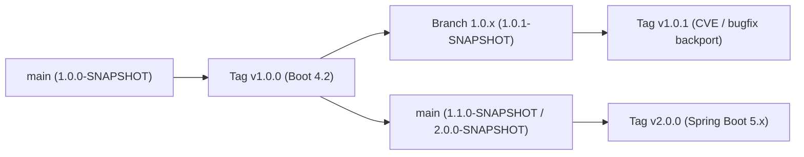

# Releasing & Multi-Version Maintenance

This page documents how `io.github.jinternals:webhooks-*` releases, `-SNAPSHOT` builds, and long-lived Spring Boot maintenance branches are managed.

---

## 1. Version & Branch Alignment with Spring Boot

Major release lines align with Spring Boot major generations so applications on an older Spring Boot major continue to receive security and bug-fix releases after `main` moves forward:

| `webhooks` Line | Spring Boot Baseline | Active Branch | Snapshot Version |
| --- | --- | --- | --- |
| **`1.x`** (`1.0.x`, `1.1.x`, …) | **Spring Boot `4.x`** (`4.2+`, Java 21+) | `main` while `4.x` is current; `1.0.x` / `1.x` for maintenance | `1.0.1-SNAPSHOT` / `1.1.0-SNAPSHOT` |
| **`2.x`** *(future)* | **Spring Boot `5.x`** | `main` once Boot 5 ships (`1.x` continues on `1.x`) | `2.0.0-SNAPSHOT` |



---

## 2. CI/CD Workflows Overview

Three workflows under [`.github/workflows/`](../../.github/workflows) handle continuous verification, snapshots, releases, and CVE scanning across **all** active branches:

1. **`ci.yml` (`main`, `N.x`, and `N.M.x`):**
   - Runs Spotless, 100% JaCoCo line/branch coverage, 100% PITest `STRONGER` mutation testing, sample verification across JDK 21 + JDK 25 (with JSpecify NullAway and Spring Boot AOT), Docker E2E suites, and Javadoc packaging.
   - **`publish-snapshot` job:** On pushes to `main`, `N.x`, or `N.M.x` whose `<version>` ends in `-SNAPSHOT`, automatically deploys `-SNAPSHOT` JARs + `-sources.jar` (`mvn -Psnapshot deploy -DskipTests`) to `https://central.sonatype.com/repository/maven-snapshots/`.
2. **`release.yml` (tags `v[0-9]+.[0-9]+.[0-9]*`):**
   - Protected by the `maven-central` GitHub Environment.
   - Verifies that `vX.Y.Z` matches `<version>` in [`pom.xml`](../../pom.xml) and `<webhooks.version>` in [`webhooks-sample/pom.xml`](../../webhooks-sample/pom.xml), rejects `-SNAPSHOT` versions, and verifies the commit is reachable from `origin/main` or an `origin/N.x` / `origin/N.M.x` maintenance branch.
   - Runs the full quality gate and sample + AOT verification on the tagged commit.
   - GPG-signs and uploads the release bundle (`mvn -Prelease deploy -DskipTests`) to Sonatype Central Portal (`autoPublish` controlled by repo variable `CENTRAL_AUTO_PUBLISH`, defaulting to `false`).
   - Publishes the GitHub Release from [`CHANGELOG.md`](../../CHANGELOG.md) using `--latest=legacy` (SemVer comparison) so a `v1.0.4` security backport on `1.0.x` never steals the **Latest** badge from `v2.0.0`.
3. **`security-scan.yml` (weekly Monday 03:00 UTC + manual dispatch):**
   - Dynamically discovers `main` plus every active `N.x` / `N.M.x` branch on `origin` (excluding any comma-separated branches in repo variable `EOL_BRANCHES`) and runs OWASP `dependency-check` (`CVSS >= 7` gate) on every supported release line in parallel.

---

## 3. Consuming `-SNAPSHOT` Builds

To test an unreleased fix from `main` or a maintenance branch (`1.0.1-SNAPSHOT`, `2.0.0-SNAPSHOT`), add the Central Portal Snapshots repository to your consumer application's `pom.xml`:

```xml
<repositories>
    <repository>
        <id>central-portal-snapshots</id>
        <name>Central Portal Snapshots</name>
        <url>https://central.sonatype.com/repository/maven-snapshots/</url>
        <releases>
            <enabled>false</enabled>
        </releases>
        <snapshots>
            <enabled>true</enabled>
        </snapshots>
    </repository>
</repositories>
```

---

## 4. Cutting a `.0` Minor / Major GA Release (e.g. `1.0.0` or `2.0.0`)

```bash
export JAVA_HOME=/Library/Java/JavaVirtualMachines/temurin-21.jdk/Contents/Home

# 1. Set release version across library and sample reactors
mvn versions:set -DnewVersion=1.0.0 -DgenerateBackupPoms=false
mvn -f webhooks-sample/pom.xml versions:set -DnewVersion=1.0.0 -DgenerateBackupPoms=false

# 2. Stamp CHANGELOG.md (move [Unreleased] entries under ## [1.0.0] - YYYY-MM-DD)
#    and update README.md dependency snippets to 1.0.0 if needed.

# 3. Verify locally, commit, push, and tag
mvn -T 1C clean verify -Pformat,release -Dgpg.skip
git add -A
git commit -m "Release 1.0.0"
git push origin main

git tag -s v1.0.0 -m "Release v1.0.0"
git push origin v1.0.0
```

Once `release.yml` finishes uploading to https://central.sonatype.com/publishing/deployments, click **Publish** (unless `CENTRAL_AUTO_PUBLISH=true` is set), then open the maintenance branch and next snapshot line:

```bash
# Create the 1.0.x maintenance branch on 1.0.1-SNAPSHOT
git checkout -b 1.0.x v1.0.0
mvn versions:set -DnewVersion=1.0.1-SNAPSHOT -DgenerateBackupPoms=false
mvn -f webhooks-sample/pom.xml versions:set -DnewVersion=1.0.1-SNAPSHOT -DgenerateBackupPoms=false
git add -A && git commit -m "Prepare 1.0.1-SNAPSHOT on 1.0.x"
git push -u origin 1.0.x

# Advance main to the next minor/major snapshot
git checkout main
mvn versions:set -DnewVersion=1.1.0-SNAPSHOT -DgenerateBackupPoms=false
mvn -f webhooks-sample/pom.xml versions:set -DnewVersion=1.1.0-SNAPSHOT -DgenerateBackupPoms=false
git add -A && git commit -m "Prepare next development iteration 1.1.0-SNAPSHOT"
git push origin main
```

---

## 5. Shipping a Security / Bugfix Backport on an Older Line (e.g. `1.0.1` while `main` is on `2.x`)

1. Land the fix on `main` first (unless the issue only affects the older Spring Boot `4.x` line).
2. Backport onto the maintenance branch via a PR targeting `1.0.x`:
   ```bash
   git fetch origin
   git checkout -b backport/1.0.x-cve-fix origin/1.0.x
   git cherry-pick -x <commit-sha-from-main>
   git push -u origin backport/1.0.x-cve-fix
   ```
3. Merge the PR into `1.0.x` once the 4 CI checks pass (which also publishes `1.0.1-SNAPSHOT`).
4. Cut `1.0.1` from `1.0.x`:
   ```bash
   git checkout 1.0.x && git pull
   mvn versions:set -DnewVersion=1.0.1 -DgenerateBackupPoms=false
   mvn -f webhooks-sample/pom.xml versions:set -DnewVersion=1.0.1 -DgenerateBackupPoms=false
   # Add ## [1.0.1] - YYYY-MM-DD to CHANGELOG.md on 1.0.x
   git add -A && git commit -m "Release 1.0.1"
   git push origin 1.0.x

   git tag -s v1.0.1 -m "Release v1.0.1"
   git push origin v1.0.1

   # Advance 1.0.x to 1.0.2-SNAPSHOT
   mvn versions:set -DnewVersion=1.0.2-SNAPSHOT -DgenerateBackupPoms=false
   mvn -f webhooks-sample/pom.xml versions:set -DnewVersion=1.0.2-SNAPSHOT -DgenerateBackupPoms=false
   git add -A && git commit -m "Prepare 1.0.2-SNAPSHOT"
   git push origin 1.0.x
   ```

---

## 6. Dependabot & Retiring End-of-Life (EOL) Branches

- **Tracking dependencies on a long-lived `1.x` branch:** When `main` moves to `2.x` (Spring Boot `5.x`), duplicate the `maven` ecosystem block in [`.github/dependabot.yml`](../../.github/dependabot.yml) with `target-branch: "1.x"` and an `ignore` rule for `org.springframework.boot*` `version-update:semver-major` so `1.x` continues receiving Spring Boot `4.x` patch/minor updates automatically.
- **Retiring an EOL branch:** Add the retired branch name to the `EOL_BRANCHES` repository variable (e.g. `1.0.x,1.1.x`) and update [`SECURITY.md`](../../SECURITY.md).
