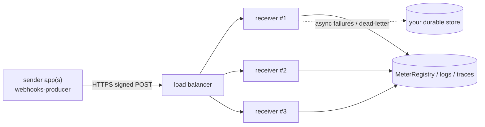
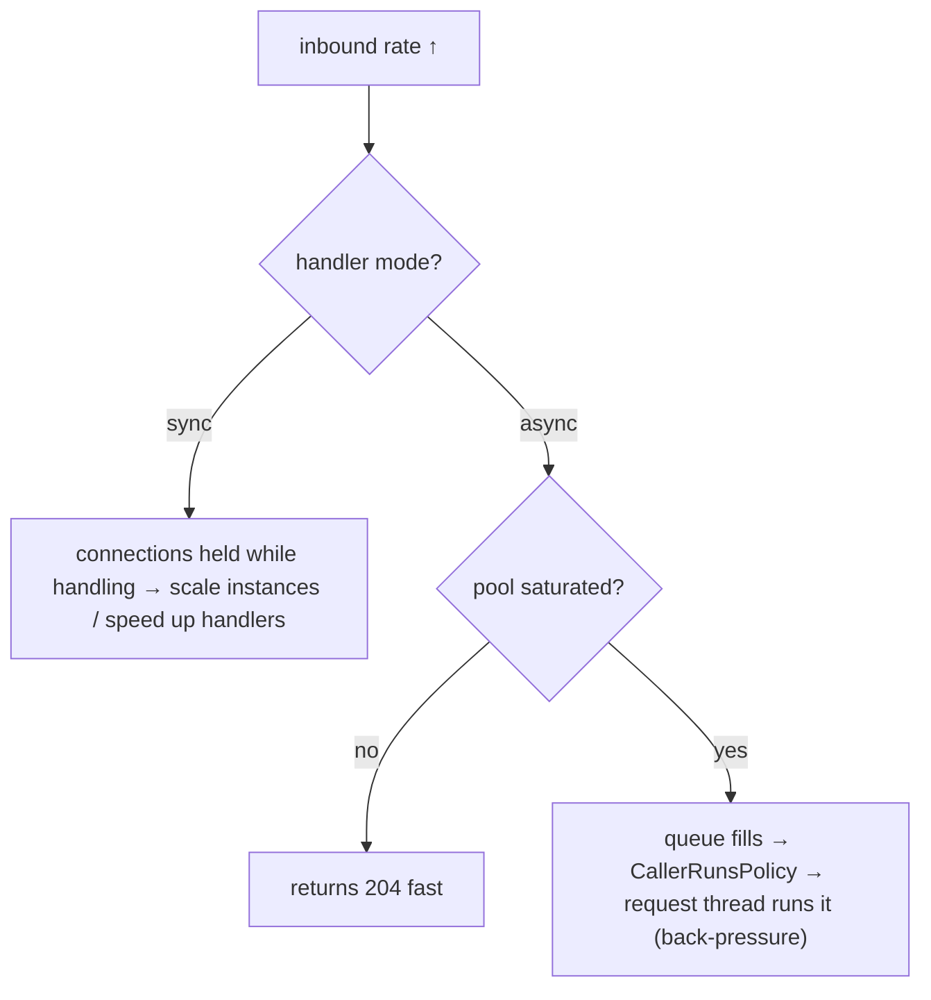
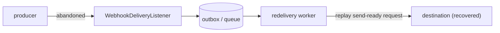

# Runbook

Running the toolkit in production: deployment topology, scaling, failure modes, and what to alert on. The
toolkit is **stateless**, which makes most of this simpler than a stateful delivery system — but the
no-storage design puts durable delivery in *your* hands.

> Background: [Architecture → no-storage design](../architecture.md#the-no-storage-design) and
> [Reliability](../guides/reliability.md).

---

## Deployment topology

Both sides are ordinary stateless Spring Boot apps. Any instance can handle any request; there is no shared
delivery state to coordinate.

**Text summary.** Senders POST signed webhooks through a load balancer to any receiver instance; receivers
are interchangeable and share nothing. Observability flows to your backends; any durable retry / dead-letter
storage is your own, fed by the toolkit's hooks.

### Topology checklist

- **TLS everywhere** — webhooks carry signed but not encrypted payloads; terminate TLS at the edge.
- **Stateless receivers** — no sticky sessions needed; scale horizontally.
- **Clock sync (NTP)** — required if the replay window is enabled (timestamps are compared to each node's
  clock). Skew beyond `replay-tolerance` rejects valid traffic.
- **Secrets from env / a manager** — never bake secrets into images; inject at runtime.

---

## Scaling

| Dimension | Lever | Notes |
| --- | --- | --- |
| Receiver throughput | add instances | stateless → linear; load-balance freely |
| Handler latency (`sync`) | keep handlers fast | a slow `sync` handler holds the sender's connection |
| Handler latency (`async`) | `core/max-pool-size`, `queue-capacity` | a full queue applies `CallerRunsPolicy` back-pressure (runs on the request thread) |
| Body-size exposure | `max-body-size` | lower it if events are small — bounds memory under load |
| Producer throughput | caller threads | delivery blocks the calling thread during retry/backoff; size caller pools accordingly |

**Text summary.** Under `sync`, inbound rate is bounded by handler speed and instance count. Under `async`,
the pool absorbs bursts until the queue fills, at which point back-pressure kicks in on the request thread —
a signal to scale handlers or instances.

---

## Failure modes

| Symptom | Likely cause | Response |
| --- | --- | --- |
| `400 reason=signature` spike | wrong/rotated secret on sender; tampering | confirm the sender's secret; check rotation state; both sides should list the other's secret during a roll |
| `400 reason=timestamp` spike | clock skew; replayed captures | check NTP on receivers; widen `replay-tolerance` only if justified; investigate replays |
| `400 reason=missing-headers` | sender not sending the signing headers | fix the sender; confirm no proxy strips `webhook-*` headers |
| `413` spike | payloads exceed `max-body-size` | raise the limit *deliberately*, or fix the sender's payload size |
| `500 endpoint not configured` | a path is served but not in `endpoints` | add the endpoint; `validate-secrets-on-startup` catches secret gaps at boot |
| `500` from handlers (sync) | handler bug / downstream outage | fix the handler; the sender's retry covers the gap meanwhile |
| rising `webhook_delivery_lag` | sender retrying heavily; receiver slow to accept | scale receivers; check sender health |
| producer `WebhookDeliveryException` rate | destination down / slow / rejecting | check destination; inspect dead-letter hook output; consider durable replay |

### When a receiver is down longer than the sender retries

The sender's retry budget is finite. If a receiver outage outlasts it, deliveries are lost **unless** you've
added durability. The pattern:

**Text summary.** Capture abandoned deliveries via `WebhookDeliveryListener` into your own outbox/queue, and
run a worker that replays the send-ready request once the destination recovers. The toolkit hands you the
exact signed request to persist; the durability policy is yours. See
[Reliability → building durable delivery](../guides/reliability.md#building-durable-delivery-on-top).

---

## What to alert on

| Alert | Threshold (tune to your traffic) | Why |
| --- | --- | --- |
| `webhook_verification_failed_total{reason="signature"}` rate | any sustained non-zero | misconfig or attack — authentic senders don't fail signature checks |
| `webhook_verification_failed_total{reason="timestamp"}` rate | sustained non-zero (replay window on) | clock drift or replay attempts |
| `webhook_delivery_lag` p99 | above your SLO | sender retrying / receiver slow |
| `webhook_handle_duration` p99 (async) | approaching `timeout` | handlers about to be interrupted |
| async handler failure rate (`HandlerFailureListener`) | any sustained non-zero | failures hidden behind the `204` — only visible here |
| producer abandon rate (`WebhookDeliveryListener`) | any sustained non-zero | deliveries being dropped — act on dead-letter backlog |

See [Observability → what to monitor](../guides/observability.md#what-to-monitor) for the signal catalog.

---

## Operational safety defaults

The shipped defaults are chosen to fail safe:

| Default | Protects against |
| --- | --- |
| `validate-secrets-on-startup=true` | a misconfigured secret surfacing as per-request `500`s the sender retries forever |
| `max-body-size=256KB` | memory/thread exhaustion from oversized POSTs |
| `in-memory-idempotency-max-size=100000` | a flood of unique `webhook-id`s exhausting memory |
| bounded retry (`max-attempts=3`) | unbounded in-process retry pinning threads |
| `jitter=0.5` | synchronized retry storms across instances |

Keep these on unless you have a specific, measured reason to change them.

---

## Related

- Delivery guarantees and the hooks → [Reliability](../guides/reliability.md)
- Signals and dashboards → [Observability](../guides/observability.md)
- Security hardening → [Verification & security](../guides/verification-and-security.md)
- Common questions → [FAQ](./faq.md)
