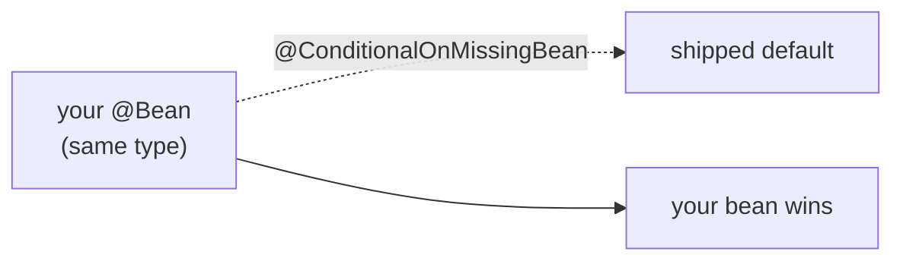
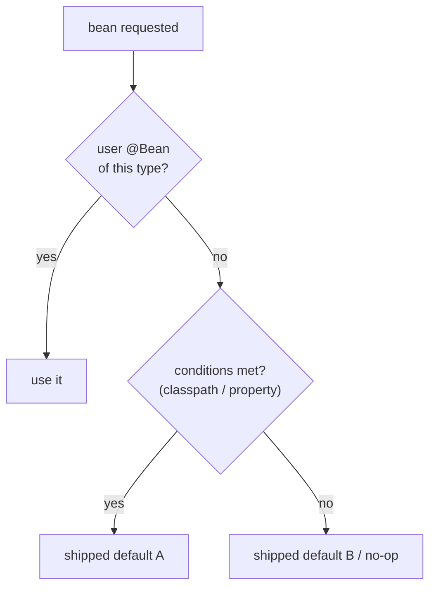

# Beans & extension points

Almost every moving part is a replaceable `@Bean`. Shipped defaults are guarded with
`@ConditionalOnMissingBean`, so to customize behavior you publish your own `@Bean` of the same type (and, where
noted below, bean name) and the default steps aside — no flags, no subclassing the auto-configuration. Additive
hooks (`MetadataContributor`, `WebhookRequestInterceptor`) accept `0..n` beans in Spring `@Order` order.



**Text summary.** Define a bean of the SPI type in your context; the matching shipped default backs off and
yours is wired everywhere the toolkit uses that type. Every example on this page has a compiled, tested
counterpart under [`webhooks-sample/`](../../webhooks-sample/README.md).

---

## Core & shared beans

| Bean / SPI | Default | Replace / provide to… |
| --- | --- | --- |
| `SecretProvider<T>` | config-backed (reads `secret` + `additional-secrets`) | resolve secrets from a secrets manager (Vault, AWS/GCP), rotate dynamically. `T` is `WebhookProperties.Endpoint` on the consumer, `WebhookProducerProperties.Destination` on the producer (**producer bean must be named `@Bean("destinationSecretProvider")`**). |
| `WebhookTypeRegistry` | classpath scan of the host app's auto-configuration packages (`@SpringBootApplication` package) | supply a custom `type → class` mapping (e.g. `WebhookTypeScanner.scan("com.acme.events")`). |
| `Clock` *(optional)* | `Clock.systemUTC()` fallback (`ObjectProvider<Clock>`) | supply a deterministic or custom `Clock` shared across replay-window checks, in-memory idempotency TTL, lag computation, signing timestamps, and `Retry-After` HTTP-date parsing. |

> [!NOTE]
> `WebhookRedactor` (`WebhookRedactor.toRedactedString(event)`) is a stateless `final` utility backed by
> `ClassValue`, not a Spring bean.

---

## Consumer SPIs

| Bean / SPI | Default | Replace / add to… |
| --- | --- | --- |
| `WebhookVerifier` | `DefaultWebhookVerifier` — selects `v1` HMAC (`whsec_`) or `v2a` Ed25519 (`whpk_`) per secret by prefix, rotation-aware; or `NoOpWebhookVerifier` when `signature-verification-enabled=false` | change the verification scheme (e.g. JWS), throwing `com.jinternals.webhooks.consumer.verify.WebhookVerificationException` on failure. Both built-in schemes need no bean swap — just the secret prefix ([asymmetric](../guides/verification-and-security.md#asymmetric-signatures-ed25519-v2a)). See [disabling verification](../guides/verification-and-security.md#disabling-verification). |
| `TimestampValidator` | `ClockSkewTimestampValidator` (`5m` default, **on by default**), or `NoOpTimestampValidator` when `replay-window-enabled=false` | implement a different freshness policy (throw `WebhookVerificationException` when stale). |
| `SecretProvider<Endpoint>` | `ConfigSecretProvider` | resolve consumer verification secrets dynamically from a secrets manager. |
| `SecretValidator` | validates every endpoint secret at startup (skipped when verification is off) | customize startup secret validation (or set `validate-secrets-on-startup=false`). |
| `IdempotencyGuard` | `NoOpIdempotencyGuard`, or `InMemoryIdempotencyGuard` when `in-memory-idempotency=true` | share reserve-then-commit dedupe across instances (Redis, DB). |
| `HandlerExecutor` | `SyncHandlerExecutor` or `AsyncHandlerExecutor` (per `handler.mode`) | run handlers your own way (custom pool, virtual threads, external queue). |
| `HandlerFailureListener` | `NoOpHandlerFailureListener` | capture `async` handler failures/timeouts (`204` was already sent). See [Reliability](../guides/reliability.md#consumer-hook--handlerfailurelistener). |
| `MetadataContributor` (`0..n`, additive) | *(none)* | enrich `WebhookMetadata.attributes()` with provider-specific fields; all beans run in `@Order` order. |
| `WebhookMetrics` | `MicrometerWebhookMetrics` (if a `MeterRegistry` exists) or `NoOpWebhookMetrics` | emit to a non-Micrometer telemetry backend. See [Observability](../guides/observability.md#opt-in-metrics). |
| `PayloadValidator` | Bean Validation on the `@WebhookType` object | plug a different validation engine. |

### Example — shared idempotency via Redis (reserve-then-commit)

`IdempotencyGuard` is a **three-method** protocol (`tryBegin`, `markProcessed`, `release`) so a handler that
throws in `sync` mode releases its reservation and lets the sender's retry run instead of dropping the event:

```java
@Bean
IdempotencyGuard redisIdempotency(StringRedisTemplate redis) {
    return new IdempotencyGuard() {
        @Override
        public boolean tryBegin(String webhookId) {
            if (webhookId == null || webhookId.isBlank()) {
                return true;
            }
            return Boolean.TRUE.equals(
                    redis.opsForValue().setIfAbsent("wh:" + webhookId, "in-flight", Duration.ofMinutes(2)));
        }

        @Override
        public void markProcessed(String webhookId) {
            if (webhookId != null && !webhookId.isBlank()) {
                redis.opsForValue().set("wh:" + webhookId, "processed", Duration.ofDays(1));
            }
        }

        @Override
        public void release(String webhookId) {
            if (webhookId != null && !webhookId.isBlank()) {
                redis.delete("wh:" + webhookId);
            }
        }
    };
}
```

Sample implementations: [`SharedStoreIdempotencyGuard.java`](../../webhooks-sample/spi-sample/src/main/java/com/jinternals/webhooks/sample/spi/SharedStoreIdempotencyGuard.java) and [`NatsKvIdempotencyGuard.java`](../../webhooks-sample/consumer-nats-sample/src/main/java/com/jinternals/webhooks/sample/consumer/nats/NatsKvIdempotencyGuard.java).

### Example — consumer secrets from a manager

```java
@Bean
SecretProvider<WebhookProperties.Endpoint> secretProvider(MySecrets secrets) {
    // Return candidate secrets newest-first; return List.of() (never null) to fail closed.
    return endpoint -> secrets.currentAndPrevious(endpoint.getPath());
}
```

Sample implementation: [`SpiSampleApplication.java`](../../webhooks-sample/spi-sample/src/main/java/com/jinternals/webhooks/sample/spi/SpiSampleApplication.java).

### Example — async handler failure hook

```java
@Bean
HandlerFailureListener handlerFailureListener(AlertService alerts) {
    return new HandlerFailureListener() {
        @Override
        public void onHandlerFailed(String type, Throwable cause) {
            alerts.notifyFailure(type, cause);
        }

        @Override
        public void onHandlerTimeout(String type) {
            alerts.notifyTimeout(type);
        }
    };
}
```

Sample implementations: [`LoggingHandlerFailureListener.java`](../../webhooks-sample/consumer-nats-sample/src/main/java/com/jinternals/webhooks/sample/consumer/nats/LoggingHandlerFailureListener.java) and [`SpiSampleApplication.java`](../../webhooks-sample/spi-sample/src/main/java/com/jinternals/webhooks/sample/spi/SpiSampleApplication.java).

### Example — enriching `WebhookMetadata` (`MetadataContributor`)

```java
@Component
public class EventSourceMetadataContributor implements MetadataContributor {
    @Override
    public void contribute(HttpServletRequest request, Map<String, String> headers, Map<String, Object> attributes) {
        String source = headers.get("x-event-source");
        if (source != null) {
            attributes.put("eventSource", source); // read via metadata.attribute("eventSource")
        }
    }
}
```

Sample implementation: [`SampleMetadataContributor.java`](../../webhooks-sample/consumer-sample/src/main/java/com/jinternals/webhooks/sample/consumer/SampleMetadataContributor.java).

---

## Producer SPIs

| Bean / SPI | Default | Replace / add to… |
| --- | --- | --- |
| `WebhookTransport` / `AttemptAwareWebhookTransport` | `RetryingWebhookTransport` → `InterceptingWebhookTransport` → `RestClientWebhookTransport` | deliver asynchronously, through a queue, or with a custom retry policy. Implement `AttemptAwareWebhookTransport` when retrying in-process so each attempt refreshes `webhook-timestamp` and `webhook-signature` while preserving `webhook-id` and the JSON envelope `timestamp`. **To add an auth header, add a `WebhookRequestInterceptor` instead** (keeps retry + the SSRF guard). |
| `WebhookRequestInterceptor` (`0..n`, additive) | *(none)* | shape the outbound request — add an `Authorization` bearer token (OAuth2 transport auth), tenancy, or tracing headers. Applied per attempt inside the transport chain in `@Order` order. See [Transport authentication](../guides/transport-authentication.md). |
| `RestClient` (`@Bean("webhookProducerRestClient")`) | timeouts from `webhooks.producer.http`, redirects disabled | tune HTTP: proxies, TLS, connection pooling. **Matched by bean name `webhookProducerRestClient`.** |
| `WebhookSigner` | `DefaultWebhookSigner` — selects `v1` HMAC (`whsec_`) or `v2a` Ed25519 (`whsk_`) per secret by prefix, dual-signs on rotation; or `NoOpWebhookSigner` when `signing-enabled=false` | change the signing scheme (e.g. JWS). Both built-in schemes need no bean swap — just the secret prefix ([asymmetric](../guides/verification-and-security.md#asymmetric-signatures-ed25519-v2a)). See [disabling signing](../guides/verification-and-security.md#disabling-signing). |
| `SecretProvider<Destination>` (`@Bean("destinationSecretProvider")`) | `ConfigDestinationSecretProvider` | resolve signing secrets from a secrets manager. **Must be named `destinationSecretProvider`** so it never collides with the consumer's `SecretProvider<Endpoint>` when both starters share an app. |
| `DestinationUrlValidator` | `AllowAllDestinationUrlValidator`, or `AllowListDestinationUrlValidator` when `security.allowed-hosts` is non-empty | custom outbound policy (CIDR blocks, private-IP / DNS-rebind protection). |
| `DestinationValidator` | validates every destination URL (`http`/`https` + host + URL guard) and secret at startup | customize startup destination validation (or set `validate-destinations-on-startup=false`). |
| `WebhookDeliveryListener` | `NoOpWebhookDeliveryListener` | capture abandoned deliveries (dead-letter, alert, enqueue for replay). See [Reliability](../guides/reliability.md#producer-hook--webhookdeliverylistener). |

### Example — producer secrets from a manager

```java
@Bean("destinationSecretProvider") // required bean name
SecretProvider<WebhookProducerProperties.Destination> destinationSecretProvider(MySecrets secrets) {
    return destination -> secrets.signingKeysFor(destination.getUrl());
}
```

Sample implementation: [`SpiSampleApplication.java`](../../webhooks-sample/spi-sample/src/main/java/com/jinternals/webhooks/sample/spi/SpiSampleApplication.java).

### Example — dead-letter capture

```java
@Bean
WebhookDeliveryListener deadLetter(OutboxRepository outbox) {
    return failure -> outbox.save(new OutboxRow(
            failure.url(), failure.headers(), failure.body(),
            failure.attempts(), failure.reason().name()));   // send-ready → replayable later
}
```

Sample implementations: [`DeadLetterDeliveryListener.java`](../../webhooks-sample/producer-nats-sample/src/main/java/com/jinternals/webhooks/sample/producer/nats/DeadLetterDeliveryListener.java) and [`SpiSampleApplication.java`](../../webhooks-sample/spi-sample/src/main/java/com/jinternals/webhooks/sample/spi/SpiSampleApplication.java).

### Example — add an OAuth2 bearer token (transport auth)

```java
@Bean
WebhookRequestInterceptor bearerTokenInterceptor(OAuth2AuthorizedClientManager clients) {
    return (url, headers, body) -> {
        String token = clients
                .authorize(OAuth2AuthorizeRequest.withClientRegistrationId("webhooks").principal("webhooks").build())
                .getAccessToken()
                .getTokenValue();

        var out = new LinkedHashMap<>(headers);   // keep the signed webhook-* headers
        out.put("Authorization", List.of("Bearer " + token));
        return out;                               // return a NEW map; never mutate the input
    };
    // Applied inside the chain, so retry + the SSRF guard still apply and each retry re-evaluates the token.
}
```

Sample implementations: [`ProducerAuthSampleApplication.java`](../../webhooks-sample/producer-auth-sample/src/main/java/com/jinternals/webhooks/sample/producer/auth/ProducerAuthSampleApplication.java) and [`TraceHeaderWebhookInterceptor.java`](../../webhooks-sample/producer-sample/src/main/java/com/jinternals/webhooks/sample/producer/trace/TraceHeaderWebhookInterceptor.java). Full OAuth2 setup: [Transport authentication guide](../guides/transport-authentication.md).

### Example — durable zero-loss transport through NATS JetStream

```java
@Bean
WebhookTransport natsWebhookTransport(JetStream jetStream, ObjectMapper mapper) {
    return (url, headers, body) -> {
        String webhookId = headers.get(WebhookHeaders.ID).get(0);
        byte[] payload = mapper.writeValueAsBytes(new OutboundWebhookMessage(url, webhookId, body, MDC.get("traceId")));
        jetStream.publish("webhooks.outbound.send", payload,
                PublishOptions.builder().stream("WEBHOOKS_OUTBOUND").messageId(webhookId).build());
    };
    // A relay worker pulls from WEBHOOKS_OUTBOUND and computes a fresh webhook-timestamp + webhook-signature
    // on every attempt so delayed retries still pass the receiver's 5m replay window.
}
```

Sample implementations: [`NatsJetStreamWebhookTransport.java`](../../webhooks-sample/producer-nats-sample/src/main/java/com/jinternals/webhooks/sample/producer/nats/NatsJetStreamWebhookTransport.java) and [`NatsOutboundRelayWorker.java`](../../webhooks-sample/producer-nats-sample/src/main/java/com/jinternals/webhooks/sample/producer/nats/NatsOutboundRelayWorker.java). Full guide: [Zero-webhook-loss queueing](../guides/zero-loss-queueing.md).

---

## How the defaults are chosen



**Text summary.** A user-provided bean always wins (`@ConditionalOnMissingBean`). Otherwise the
auto-configuration picks a shipped default based on classpath (`@ConditionalOnClass`, e.g. Micrometer) and
properties (e.g. `handler.mode`, `in-memory-idempotency`, `replay-window-enabled`) — resolving the
registry-dependent metrics bean at creation time so it's immune to auto-config ordering.

---

## Related

- Configuration-driven alternatives to replacing a bean → [Configuration reference](./configuration.md).
- The annotations that drive scanning → [Annotations](./annotations.md).
- Runnable SPI examples → [`webhooks-sample`](../../webhooks-sample/README.md).
- The full SPI contracts and rationale → [`SPEC.md`](./SPEC.md).
