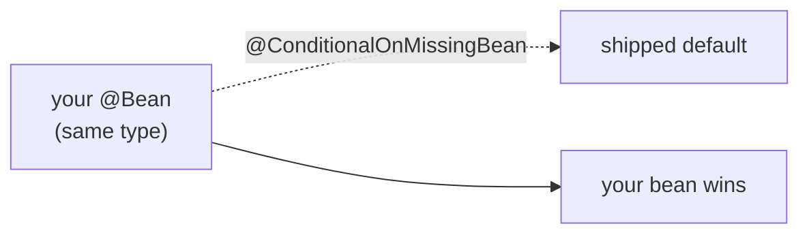
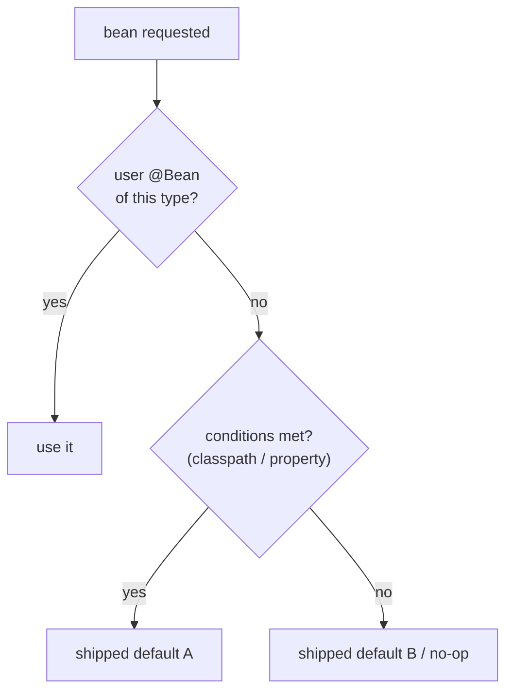

# Beans & extension points

Almost every moving part is a replaceable `@Bean`. Each shipped bean is `@ConditionalOnMissingBean`, so to
customize behavior you publish your own `@Bean` of the same type and the default steps aside — no flags, no
subclassing the auto-configuration.



**Text summary.** Define a bean of the SPI type in your context; the matching shipped default backs off and
yours is wired everywhere the toolkit uses that type.

---

## Core (both sides)

| Bean / SPI | Default | Replace to… |
| --- | --- | --- |
| `SecretProvider<T>` | config-backed (reads `secret` + `additional-secrets`) | resolve secrets from a secrets manager (Vault, AWS/GCP), rotate dynamically. Generic `T` is `Endpoint` on the consumer, `Destination` on the producer. |
| `WebhookTypeRegistry` | classpath scan of the host app's auto-configuration packages (its `@SpringBootApplication` package) | supply a custom `type → class` mapping (e.g. from a registry service). |
| `WebhookRedactor` | masks `@Redact` fields | change the masking strategy (hash instead of `***`, partial reveal). |

---

## Consumer SPIs

| Bean / SPI | Default | Replace to… |
| --- | --- | --- |
| `WebhookVerifier` | `DefaultWebhookVerifier` — selects `v1` HMAC (`whsec_`) or `v2a` Ed25519 (`whpk_`) per secret by prefix, rotation-aware; or `NoOpWebhookVerifier` when `signature-verification-enabled=false` | change the verification scheme (e.g. JWS). Both built-in schemes need no bean swap — just the secret prefix ([asymmetric](../guides/verification-and-security.md#asymmetric-signatures-ed25519-v2a)). Disabling is config, not a bean swap. See [disabling verification](../guides/verification-and-security.md#disabling-verification). |
| `HandlerExecutor` | `SyncHandlerExecutor` or `AsyncHandlerExecutor` (per `handler.mode`) | run handlers your own way (custom pool, virtual threads, external queue). |
| `HandlerFailureListener` | `NoOpHandlerFailureListener` | capture async handler failures/timeouts (dead-letter, alert). See [Reliability](../guides/reliability.md#consumer-hook--handlerfailurelistener). |
| `IdempotencyGuard` | `NoOpIdempotencyGuard`, or `InMemoryIdempotencyGuard` when `in-memory-idempotency=true` | share dedupe across instances (Redis, DB). |
| `TimestampValidator` | `ClockSkewTimestampValidator` (`5m` default), or `NoOpTimestampValidator` when `replay-window-enabled=false` | implement a different freshness policy. |
| `SecretValidator` | validates every endpoint secret at startup (skipped when verification is off) | customize or disable startup secret validation. |
| `MetadataContributor` | *(none; opt-in)* | add provider-specific fields into `WebhookMetadata.attributes()`. |
| `WebhookMetrics` | `MicrometerWebhookMetrics` (if a registry exists) or `NoOpWebhookMetrics` | emit to a non-Micrometer backend. See [Observability](../guides/observability.md#opt-in-metrics). |
| `PayloadValidator` | Bean Validation on the `@WebhookType` object | plug a different validation engine. |

### Example — shared idempotency via Redis

```java
@Bean
IdempotencyGuard redisIdempotency(StringRedisTemplate redis) {
    return webhookId -> redis.opsForValue()
            .setIfAbsent("wh:" + webhookId, "1", Duration.ofDays(1));   // true = first time seen
}
```

### Example — secrets from a manager

```java
@Bean
SecretProvider<WebhookProperties.Endpoint> secretProvider(MySecrets secrets) {
    return endpoint -> List.of(secrets.current(endpoint.getPath()));   // candidate secrets to try
}
```

---

## Producer SPIs

| Bean / SPI | Default | Replace to… |
| --- | --- | --- |
| `WebhookTransport` | `RetryingWebhookTransport` → `InterceptingWebhookTransport` → `RestClientWebhookTransport` | deliver asynchronously, through a queue, or with a different retry policy. **To add an auth header, add a `WebhookRequestInterceptor` instead** (keeps retry + the SSRF guard). |
| `WebhookRequestInterceptor` (0..n) | none | shape the outbound request — add an `Authorization` bearer token (OAuth2 transport auth), tenancy, or tracing headers. Applied inside the transport chain. See [Transport authentication](../guides/transport-authentication.md). |
| `RestClient` (`webhookProducerRestClient`) | timeouts from `webhooks.producer.http` | tune HTTP: proxies, TLS, connection pooling, interceptors. |
| `WebhookSigner` | `DefaultWebhookSigner` — selects `v1` HMAC (`whsec_`) or `v2a` Ed25519 (`whsk_`) per secret by prefix, dual-signs on rotation; or `NoOpWebhookSigner` when `signing-enabled=false` | change the signing scheme (e.g. JWS). Both built-in schemes need no bean swap — just the secret prefix ([asymmetric](../guides/verification-and-security.md#asymmetric-signatures-ed25519-v2a)). Disabling is config, not a bean swap. See [disabling signing](../guides/verification-and-security.md#disabling-signing). |
| `SecretProvider<Destination>` | config-backed | resolve signing secrets from a secrets manager. |
| `DestinationUrlValidator` | allow-list from `security.allowed-hosts` | custom outbound policy (CIDR blocks, DNS-rebind protection). |
| `DestinationValidator` | validates every destination URL + secret at startup | customize or disable startup destination validation. |
| `WebhookDeliveryListener` | no-op | capture abandoned deliveries (dead-letter, alert, enqueue for replay). See [Reliability](../guides/reliability.md#producer-hook--webhookdeliverylistener). |

### Example — dead-letter capture

```java
@Bean
WebhookDeliveryListener deadLetter(OutboxRepository outbox) {
    return failure -> outbox.save(new OutboxRow(
            failure.url(), failure.headers(), failure.body(),
            failure.attempts(), failure.reason().name()));   // send-ready → replayable later
}
```

### Example — add an OAuth2 bearer token (transport auth)

```java
@Bean
WebhookRequestInterceptor bearerTokenInterceptor(OAuth2AuthorizedClientManager clients) {
    return (url, headers, body) -> {
        String token = clients
                .authorize(OAuth2AuthorizeRequest.withClientRegistrationId("webhooks").principal("webhooks").build())
                .getAccessToken()
                .getTokenValue();

        var out = new LinkedHashMap<>(headers);   // keep the signed webhook-* headers
        out.put("Authorization", List.of("Bearer " + token));
        return out;                               // return a NEW map; never mutate the input
    };
    // Applied inside the chain, so retry + the SSRF guard still apply and each retry re-evaluates the token.
}
```

> The full runnable version (with the `spring.security.oauth2.client` registration) is in the
> [Transport authentication guide](../guides/transport-authentication.md).

### Example — async transport through a queue

```java
@Bean
WebhookTransport queueingTransport(MyQueue queue) {
    return (url, headers, body) -> queue.enqueue(new OutboundMessage(url, headers, body));
    // Your worker drains the queue and performs the actual signed POST — full durable delivery.
    // Replacing the transport is for changing the DELIVERY MECHANISM — not for adding a header.
}
```

---

## How the defaults are chosen



**Text summary.** A user-provided bean always wins (`@ConditionalOnMissingBean`). Otherwise the
auto-configuration picks a shipped default based on classpath (`@ConditionalOnClass`, e.g. Micrometer) and
properties (e.g. `handler.mode`, `in-memory-idempotency`) — resolving the registry-dependent metrics bean at
creation time so it's immune to auto-config ordering.

---

## Related

- Configuration-driven alternatives to replacing a bean → [Configuration reference](./configuration.md).
- The annotations that drive scanning → [Annotations](./annotations.md).
- The full SPI contracts and rationale → [`SPEC.md`](./SPEC.md).
