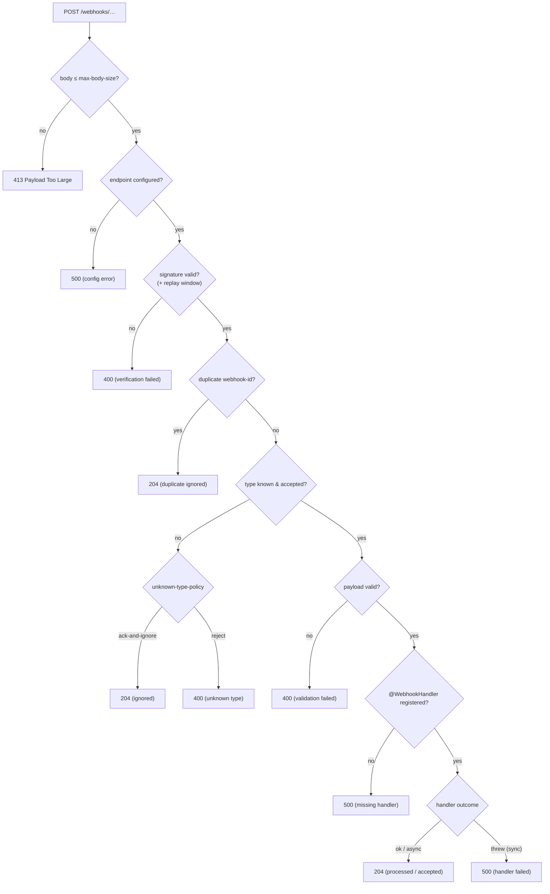

# HTTP status codes

What the **consumer** returns, and why. Every status is chosen so the **sender** does the right thing — retry
a `5xx`, stop on a `4xx`, give up gracefully on a `204`. All error responses are RFC 7807 `ProblemDetail`
bodies (`application/problem+json`), produced by the `GlobalExceptionHandler`.

**Text summary.** Size is checked first (`413` before the body is fully read), then endpoint config (`500` if
missing), then signature/replay (`400`), then optional `webhook-id` deduplication (`204`), then type routing
(`204` or `400` per policy), then strict deserialize + Bean Validation (`400`), then handler lookup (`500` if
missing in both `sync` and `async` modes), then dispatch. A clean `sync` handler or any `async` accept returns
`204`; a thrown `sync` handler returns `500`.

---

## Status reference

| Status | When | Sender should | Source |
| --- | --- | --- | --- |
| **204 No Content** | Verified and processed (`sync`) or accepted (`async`); **or** a duplicate `webhook-id` ignored; **or** an unknown type under `ack-and-ignore`. | treat as success — stop retrying | controller |
| **400 Bad Request** | Verification failed (missing headers, no secret, bad timestamp, bad signature); **or** malformed JSON / unknown JSON field / Bean Validation failure; **or** unknown type under `reject`. | **not** retry — the request is malformed/unauthentic | `WebhookVerificationException`, `InvalidPayloadException`, `PayloadValidationException`, `UnknownTypeException` |
| **413 Payload Too Large** | Body exceeds `max-body-size` (checked before verification). | not retry unless it shrinks the payload | `PayloadTooLargeException` |
| **500 Internal Server Error** | Endpoint not configured; **or** a modelled `@WebhookType` has no `@WebhookHandler`; **or** a `sync` handler threw; **or** any unexpected error. | **retry** — it's a server-side problem that may resolve | `EndpointNotConfiguredException`, `NoWebhookHandlerException`, handler exception, `Exception` |

---

## Why these choices

- **`204`, not `200`.** A webhook receiver has no body to return; `204` is the honest "accepted, nothing to
  say." Under `ack-and-ignore` an unmodelled type also gets `204` so the sender **stops retrying** something
  you'll never handle.
- **`400` for verification and validation.** These are client faults — a `4xx` tells a well-behaved sender to
  stop retrying, because retrying an unauthentic or malformed request will never succeed. Verification
  failures (`WebhookVerificationException`) also record a low-cardinality `reason` tag on
  `webhook.verification.failed` (`missing-headers`, `no-secret`, `timestamp`, `signature`, `other`). See
  [Observability → metrics](../guides/observability.md#opt-in-metrics).
- **`413` before verification.** The body-size check runs first so an oversized or slow POST is rejected
  without reading it all into memory — a cheap DoS guard. See
  [Verification & security](../guides/verification-and-security.md#why-verification-is-first).
- **`500` for handler failure (sync).** A thrown `sync` handler is a *server* problem; returning `5xx` lets
  the **sender's retry** be your durability mechanism — the delivery wasn't acked, so it comes back. In
  `async` mode the `204` was already sent, so the failure routes to `HandlerFailureListener` instead. See
  [Reliability → sync vs async](../guides/reliability.md#sync-vs-async-handling).
- **`500` for unconfigured endpoint.** This can only happen through misconfiguration; `validate-secrets-on-startup`
  catches the common cases at boot so you see them before traffic arrives.

---

## Producer side

The producer isn't an HTTP server, but it **classifies** the status codes it *receives* from destinations:

| Received status | Classification | Behavior |
| --- | --- | --- |
| `2xx` | success | delivered — return normally |
| `429`, `5xx` | retryable | retry with backoff (honors `Retry-After`) up to `max-attempts` |
| `3xx` redirects, other `4xx` | fatal | redirects are never followed (`Redirect.NEVER`); throw immediately — never retried |
| transport error (timeout, refused) | retryable | retry with backoff |

See [Reliability → producer retry](../guides/reliability.md#producer-retry--backoff).

---

## Related

- The pipeline that produces these codes → [Architecture → receive pipeline](../architecture.md#consumer-the-receive-pipeline)
- Verification failures in detail → [Verification & security](../guides/verification-and-security.md)
- Metric `reason` vocabulary → [Observability](../guides/observability.md#opt-in-metrics)
