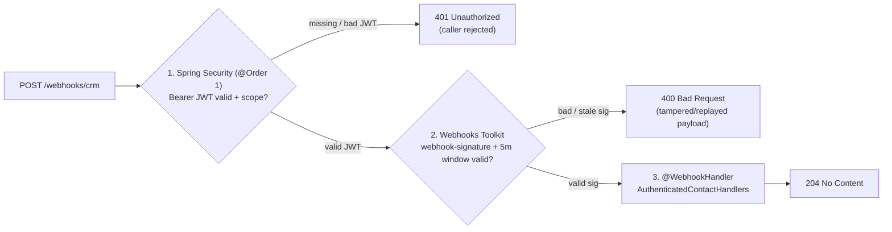

# `consumer-auth-sample` — OAuth2 Resource Server + Standard Webhooks Receiver

Standalone Spring Boot application (`:9095`) demonstrating **dual-layer inbound webhook security**: a Spring
Security OAuth2 Resource Server filter chain (`401`) in front of the Webhooks Toolkit's signature + replay
verifier (`400`).

## How it works



### Why keep both layers

- **Transport auth (`Authorization: Bearer <jwt>` → `401`):** Authenticates *who is calling* at the HTTP edge
  (`SCOPE_webhooks:deliver`) before the webhook controller is invoked.
- **Message auth (`webhook-signature` → `400`):** Authenticates that the *raw JSON payload* was signed by the
  secret holder and was not modified by an intermediary or proxy.

## Run & test

```bash
# Run @SpringBootTest (proves 401 on missing JWT, 400 on valid JWT + bad sig, 204 when both pass)
mvn -pl consumer-auth-sample test

# Run live with producer-auth-sample via Docker Compose
docker compose -f docker-compose.auth.yml up --build -d
```
