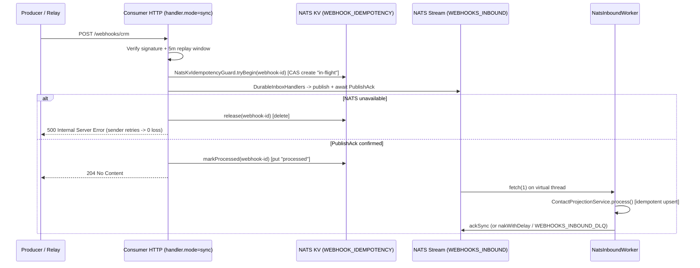

# `consumer-nats-sample` — Zero-Loss Queued Webhook Receiver (NATS JetStream + KV)

Standalone Spring Boot application (`:9093`) showing how to guarantee **zero inbound webhook loss** across
JVM crashes (`kill -9`), multi-instance deployments, and downstream database outages using **NATS JetStream**
and **NATS KeyValue**.

## How it works



### Key design choices

1. **`handler.mode: sync` + `PublishAck` before `204`:** Unlike in-memory `async` mode (where a crash after
   `204` loses queued work), `DurableInboxHandlers` runs synchronously on the HTTP thread, persists the
   verified event into `WEBHOOKS_INBOUND`, and returns `204` **only after** NATS confirms `PublishAck`
   (~sub-millisecond).
2. **Crash-safe multi-pod idempotency (`NatsKvIdempotencyGuard`):**
   - `"processed"` → returns `false` (`204` duplicate suppressed).
   - Active `"in-flight"` (`age ≤ 30s`) → throws `500` *without* releasing the active pod's lock so a
     concurrent duplicate backs off instead of getting a premature `204`.
   - Expired `"in-flight"` (`age > 30s`, e.g. sibling pod killed via `SIGKILL` before `PublishAck`) →
     reclaims the lease atomically with `kv.update(key, "in-flight", entry.getRevision())`.
3. **Event ordering:** Because `NatsInboundWorker` processes messages concurrently across virtual threads and
   pods (and retries failed messages with `nakWithDelay`), events can complete out of order. Make projection
   logic order-tolerant (compare `eventTimestamp()` / entity version) or shard subjects by entity ID with
   `maxAckPending = 1` per shard when strict per-entity ordering is needed.

## Run & test

```bash
# From webhooks-sample/
# 1) Offline @SpringBootTest suite (verifies happy path, NATS outage 500+release, pod crash lease recovery, DLQ)
mvn -pl consumer-nats-sample test

# 2) End-to-end Docker integration test (starts NATS + producer-nats + consumer-nats, asserts delivery, tears down)
./integration-test-nats.sh

# 3) Or keep the stack running interactively:
docker compose -f docker-compose.nats.yml up --build -d
```
