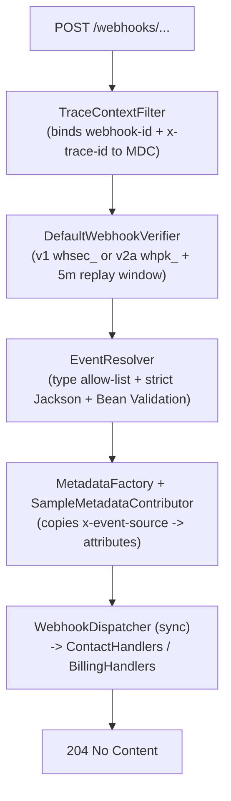

# `consumer-sample` — Quickstart Webhook Receiver (`v1` & `v2a`)

Standalone Spring Boot application (`:9091`) demonstrating **`webhooks-consumer-starter`** out of the box:
runtime endpoint registration, `v1` HMAC (`whsec_`) and `v2a` Ed25519 (`whpk_`) verification, `5m` replay
window, strict JSON deserialization + Jakarta Bean Validation, `@Redact` PII masking, `MetadataContributor`,
and Micrometer/Prometheus metrics.

## How it works



### Configured endpoints (`src/main/resources/application.yaml`)

| Path | Scheme | Accepted `types` | Handler bean |
| --- | --- | --- | --- |
| `POST /webhooks/crm` | `v1` (`whsec_…`) | `contact.created`, `contact.updated`, `contact.deleted` | `ContactHandlers` |
| `POST /webhooks/crm-v2a` | `v2a` (`whpk_…` + `endpoint-id`) | `contact.created`, `contact.updated`, `contact.deleted` | `ContactHandlers` (same handlers — scheme is transparent!) |
| `POST /webhooks/billing/invoice-paid` | `v1` (`whsec_…`) | `invoice.paid` | `BillingHandlers` |

### Key classes & scripts

| File | Role |
| --- | --- |
| `events/*` | `@WebhookType` POJOs carrying Bean Validation (`@NotBlank`, `@Positive`, `@Size`) and `@Redact` annotations. |
| `handlers/ContactHandlers`, `BillingHandlers` | `@WebhookHandler` methods demonstrating `(Event, WebhookMetadata)` and `(WebhookMetadata, Event)` parameter orders plus `metadata.redactedEvent()` (single-arg `(Event)` is also supported). |
| `SampleMetadataContributor` | `MetadataContributor` copying `x-event-source` into `metadata.attribute("eventSource")`. |
| `trace/TraceContextFilter` | Servlet filter binding `webhook-id` and `x-trace-id` into SLF4J `MDC`. |
| `sign.py` / `smoke-test.sh` / `load-test.*` | Local CLI helpers to sign payloads and smoke/load-test the receiver directly. |

## Run & test

```bash
# From webhooks-sample/
mvn -pl consumer-sample test
mvn -pl consumer-sample spring-boot:run

# Run standalone smoke checks against :9091
./consumer-sample/smoke-test.sh
```
