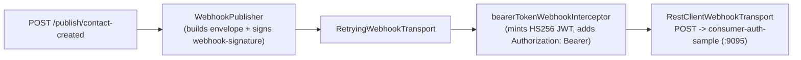

# `producer-auth-sample` — OAuth2 / JWT Bearer Webhook Sender

Standalone Spring Boot application (`:9094`) demonstrating how to layer **HTTP transport authentication**
(`Authorization: Bearer <jwt>`) on top of Standard Webhooks `v1` HMAC message signatures using
**`WebhookRequestInterceptor`**.

## How it works



### Why `WebhookRequestInterceptor` instead of replacing `WebhookTransport`

- Runs **inside** the default transport chain (`RetryingWebhookTransport -> InterceptingWebhookTransport -> RestClientWebhookTransport`), so built-in retry, `Retry-After` handling, dead-letter hooks, and SSRF URL validation all stay active.
- Runs **per attempt**: if a short-lived access token expires during retry backoff on a `503`/`429`, the next attempt mints/fetches a fresh token automatically.
- Returns a **new** `LinkedHashMap<>(headers)` preserving `webhook-id`, `webhook-timestamp`, and `webhook-signature` untouched so both authentication layers travel together.

## Run & test

```bash
# From webhooks-sample/
# Run @SpringBootTest (verifies JWT bearer header + webhook-* headers across retry attempts)
mvn -pl producer-auth-sample test

# Run end-to-end Docker integration test with consumer-auth-sample
./integration-test-auth.sh
```
