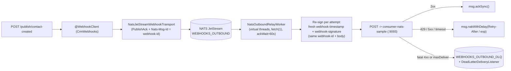

# `producer-nats-sample` — Zero-Loss Queued Webhook Sender (NATS JetStream)

Standalone Spring Boot application (`:9092`) showing how to eliminate outbound webhook loss across restarts
and multi-hour receiver outages by backing **`WebhookTransport`** with **NATS JetStream**.

## How it works



### Why fresh per-attempt signing is critical

Standard Webhooks receivers enforce `|now − webhook-timestamp| ≤ 5m` (`replay-window-enabled: true`). If a
queue stored the initial `headers` and replayed them after a 20-minute outage, the receiver would reject the
message with `400 Bad Request (timestamp)`.

`NatsJetStreamWebhookTransport` stores `(url, webhookId, body, traceId)` without freezing the signature. On
every delivery attempt, `NatsOutboundRelayWorker` computes a **fresh `webhook-timestamp` and
`webhook-signature`** over `webhookId.freshTimestamp.body` while keeping `webhook-id` and the JSON envelope
`timestamp` unchanged.

### Multi-instance & ordering behavior

- **Horizontal scaling:** Multiple `producer-nats-sample` instances safely share the durable pull consumer
  `webhooks-outbound-relay`. Each virtual-thread worker owns its own `JetStreamSubscription` and calls
  `fetch(1, 1s)` with `ackWait = 60s` (`> connectTimeout + readTimeout`).
- **Event ordering:** Strict FIFO ordering is **not** preserved across concurrent worker threads or when an
  earlier message enters `nakWithDelay` retry backoff while a later message succeeds. Downstream consumers
  should treat webhooks as out-of-order-safe (using `envelope.timestamp` / version checks), or partition
  subjects by entity key with `maxAckPending = 1` per shard if strict per-entity serialization is required.

## Run & test

```bash
# From webhooks-sample/
# 1) Offline @SpringBootTest suite (uses in-memory JetStream test harness + local HttpServer)
mvn -pl producer-nats-sample test

# 2) End-to-end Docker integration test (starts NATS + producer-nats + consumer-nats, asserts delivery, tears down)
./integration-test-nats.sh

# 3) Or keep the stack running interactively:
docker compose -f docker-compose.nats.yml up --build -d
```
