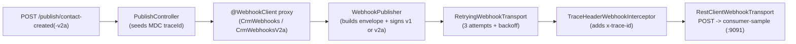

# `producer-sample` — Quickstart Webhook Sender (`v1` & `v2a`)

Standalone Spring Boot application (`:9090`) demonstrating **`webhooks-producer-starter`** out of the box:
declarative `@WebhookClient` interfaces, symmetric `v1` HMAC (`whsec_`) and asymmetric `v2a` Ed25519 (`whsk_`)
signing, in-process retry with `Retry-After` support, and `x-trace-id` MDC propagation.

## How it works



### Key classes

| Class | Role |
| --- | --- |
| `ProducerSampleApplication` | `@SpringBootApplication` + `@EnableWebhookClients(clients = {CrmWebhooks.class, CrmWebhooksV2a.class})` (explicit, zero-scan registration). |
| `events/ContactCreated` | `@WebhookType("contact.created")` payload serialized into the envelope's `data` field. |
| `client/CrmWebhooks` | `@WebhookClient(destination = "demo")` — signs with `whsec_` (`v1` HMAC-SHA256) and POSTs to `/webhooks/crm`. |
| `client/CrmWebhooksV2a` | `@WebhookClient(destination = "demo-v2a")` — signs with `whsk_` (`v2a` Ed25519 + `endpoint-id`) and POSTs to `/webhooks/crm-v2a`. |
| `trace/TraceHeaderWebhookInterceptor` | `WebhookRequestInterceptor` copying `MDC.get("traceId")` onto `x-trace-id` on every attempt while keeping signed `webhook-*` headers intact. |
| `web/PublishController` | Demo trigger endpoints (`POST /publish/contact-created` and `POST /publish/contact-created-v2a`). |

## Run & test

```bash
# From webhooks-sample/ (after installing starters from repo root)
mvn -pl producer-sample test
mvn -pl producer-sample spring-boot:run
```

Trigger a webhook (with `consumer-sample` running on `:9091`):

```bash
# Symmetric v1 (HMAC-SHA256)
curl -i -X POST http://localhost:9090/publish/contact-created \
  -H 'content-type: application/json' \
  -d '{"id":"c-1","fullName":"Ada Lovelace","email":"ada@example.com"}'

# Asymmetric v2a (Ed25519)
curl -i -X POST http://localhost:9090/publish/contact-created-v2a \
  -H 'content-type: application/json' \
  -d '{"id":"c-2","fullName":"Grace Hopper","email":"grace@example.com"}'
```
