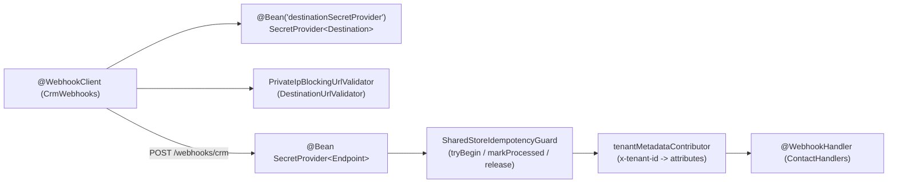

# `spi-sample` — Custom SPI Beans & Single-App Coexistence

Standalone Spring Boot application (`:9096`) demonstrating:

1. **Coexistence** of `webhooks-consumer-starter` and `webhooks-producer-starter` inside a **single** Spring
   Boot application context with zero bean collisions.
2. **Custom `@Bean` overrides** for the extension points documented in
   [`docs/reference/beans-and-spis.md`](../../docs/reference/beans-and-spis.md).

## How it works



### Custom SPI beans wired in `SpiSampleApplication`

| SPI | Custom bean in sample | Key detail |
| --- | --- | --- |
| `SecretProvider<Endpoint>` | `endpointSecretProvider()` | Resolves active + rotating consumer secrets dynamically (none stored in `application.yaml`). |
| `SecretProvider<Destination>` | `@Bean("destinationSecretProvider")` | **Must** use bean name `"destinationSecretProvider"` so it overrides `ConfigDestinationSecretProvider` without colliding with `SecretProvider<Endpoint>`. |
| `IdempotencyGuard` | `SharedStoreIdempotencyGuard` | Implements the 3-method reserve-then-commit protocol (`tryBegin`, `markProcessed`, `release`). |
| `DestinationUrlValidator` | `PrivateIpBlockingUrlValidator` | Custom SSRF guard blocking link-local (`169.254.169.254`) and RFC-1918 private IPs. |
| `MetadataContributor` | `tenantMetadataContributor()` | Additive (`0..n`) contributor copying `x-tenant-id` into `metadata.attribute("tenantId")`. |
| `HandlerFailureListener` & `WebhookDeliveryListener` | `RecordedHooks` | Captures async handler failures/timeouts and abandoned outbound `DeliveryFailure`s. |

## Run & test

```bash
# From webhooks-sample/
mvn -pl spi-sample test
mvn -pl spi-sample spring-boot:run

# Trigger loopback publish -> verify -> handle via custom SPIs:
curl -i -X POST http://localhost:9096/publish/contact-created \
  -H 'content-type: application/json' \
  -d '{"id":"c-spi-1","fullName":"Ada Lovelace","email":"ada@example.com"}'
```
